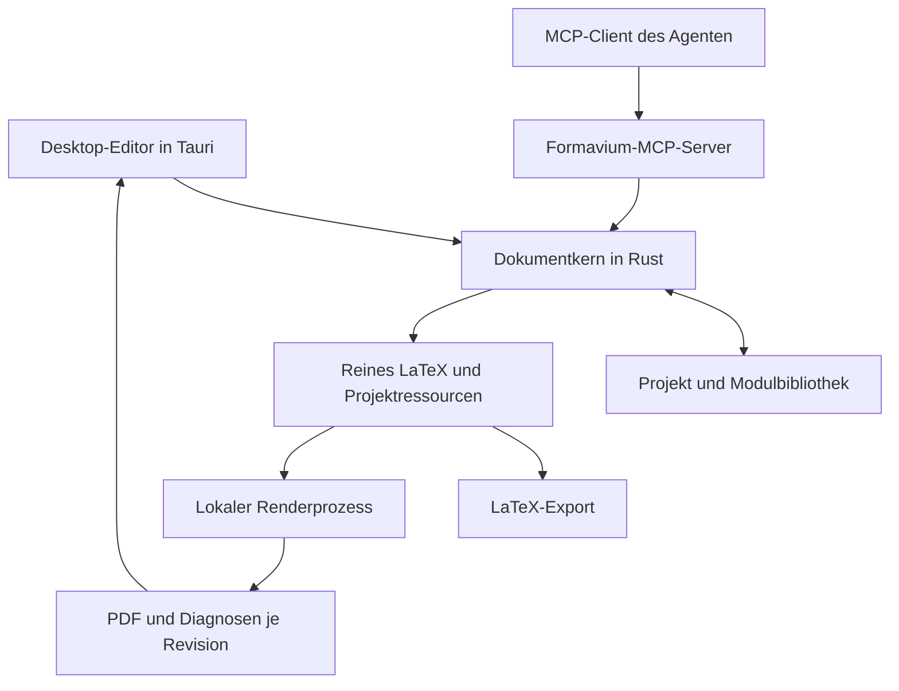

# Formavium – Anforderungen und Planungsstand

**Hauptplanung · Planungsfassung 1.2 · 25. November 2026 · Version 1 und Erweiterungsrecherche**

Formavium ist eine lokale Desktop-Anwendung für wiederkehrende Dokumente. Wer eine Anleitung, ein Datenblatt oder einen Bericht erstellt, kann Bausteine selbst gestalten, zusammensetzen und beim nächsten Dokument wiederverwenden. Der Abnahmenachweis ist das zweite Dokument aus derselben Vorlage mit neuen Werten, eigenem Bild und konsistentem Firmenlayout.

**Geltung.** Die Kapitel 1 bis 8 bilden die Planungsgrundlage für Version 1. Vorlagen und Modulversionen werden ausschließlich lokal verwaltet. Programmupdates dürfen online bezogen werden. Externe Agenten können Formavium über das Model Context Protocol (MCP) bedienen. Als Planungsannahme für die erste Auslieferung dient ein MCP-Client am Arbeitsplatz. Der Editor und seine drei aufeinander aufbauenden Übungen funktionieren auch ohne Internet. Die Technikauswahl ist ein begründeter Arbeitsstand für die Entwicklung. Prüfaufträge haben einen beschriebenen Erfolgsfall und einen Ausweichweg. Das ursprüngliche Sitzungsprotokoll und der Projektauftrag stehen am Ende als historischer Anhang. Frühere offene Fragen sind nach dem Stand der Hauptplanung zu lesen.

**Für den Entwicklungsstart.** Kapitel 1 beschreibt den fertigen Nutzerablauf, Kapitel 2, 3 und 6 die technischen Verträge. Kapitel 4 und 7 ordnen die Arbeit. Die ersten beiden Arbeitspakete in Kapitel 7 führen auf Windows vom lokalen Build zum ersten offline erzeugten PDF. Kapitel 5 trennt die lokale Bibliothek vom Updatekanal der Anwendung. Kapitel 8 führt die Abnahmen, Versuche und Freigabeentscheidungen zusammen. Produktivcode, Windows-Messungen und Release-Artefakte entstehen in der anschließenden Entwicklungsphase. Kapitel 9 untersucht Erweiterungen und Geschäftsmodelle nach Version 1. Die dort beschriebenen Piloten sind Vorschläge für künftige Produktentscheidungen.

## 1. Welches Ergebnis die erste Version liefern soll

**Referenzablauf für die Abnahme.** Eine Vorlagenautorin baut das Modul „Materialliste“ aus einer Tabelle und einem Bildfeld. Sie gibt Titel und Tabellenwerte zur Bearbeitung frei. Sie verwendet das Modul in einer Anleitung und in einer zweiten Vorlage. An demselben Testarbeitsplatz beginnt ein Dokumentautor mit der Anleitung, fügt eigene Werte und ein Foto ein, verschiebt eine Spalte und ergänzt einen freien LaTeX-Abschnitt. Er speichert das Dokument, öffnet es erneut, kontrolliert die PDF-Vorschau und gibt ein PDF sowie ein eigenständig kompilierbares LaTeX-Projekt aus. Die zweite Vorlage behält ihren Aufbau. Eine später in der lokalen Bibliothek gespeicherte Modulversion verändert das gespeicherte Dokument erst durch eine bewusste Übernahme.

**Lieferumfang für Version 1.** Der erste Meilenstein enthält Bearbeitung und Rendering. Die Abnahme der ersten nutzbaren Version umfasst zusätzlich den vollständigen Weg vom selbst gebauten Modul zum zweiten Dokument.

| Zur ersten nutzbaren Version                                                    | Abnahme aus Sicht des Anwenders                                                                                                                                                                                                                                                                                                                      |
| ------------------------------------------------------------------------------- | ---------------------------------------------------------------------------------------------------------------------------------------------------------------------------------------------------------------------------------------------------------------------------------------------------------------------------------------------------- |
| Lokale Desktop-App für Windows, auch am ersten Tag offline und ohne Adminrechte | Frisches Benutzerprofil, leere Anwendungscaches, Netz getrennt. Installation, Start, Bearbeitung und erstes PDF mit Bild und mitgelieferter Schrift gelingen.                                                                                                                                                                                        |
| Drei Ansichten desselben Projekts, einzeln oder als Split-View                  | PDF-Vorschau, visueller Editor für definierte Objekte und reiner LaTeX-Quelltext. Freier Quelltext wird ausgegeben und bleibt beim Wechsel der Ansicht erhalten. Das Mock-up ist eine Bedienidee, die endgültige Desktop-Gestaltung ist offen.                                                                                                       |
| Nativer Modul- und Vorlagenbau                                                  | Text, Tabelle, Bild und horizontale Anordnung lassen sich verschachteln. Ein Modulautor definiert Eingabefelder visuell oder aus einer Quelltextauswahl. Auch ein spontan im offenen Dokument angelegtes Modul kann in die Bibliothek übernommen werden.                                                                                             |
| Dokumente aus Vorlagen                                                          | Ein Anwender beginnt mit einer gespeicherten Zusammenstellung. Module und Spalten lassen sich für diese Verwendung ändern. Der Vorlagenautor kann Module als erforderlich oder optional kennzeichnen. Der Anwender kann Abschnitte frei anspringen.                                                                                                  |
| Bibliothek und Versionswahl                                                     | Treffer haben Namen und Vorschau. Textsuche und anklickbare Inhaltsfilter finden auch Inhalte aus Untermodulen. Mehrere Inhaltsfilter gelten gemeinsam. Beim Erstellen aus einer Vorlage kann der Nutzer den bisherigen Stand behalten, nur das neue Dokument aktualisieren oder die neue Version auch zum Vorlagenstandard machen.                  |
| Tabellen und Datenübernahme                                                     | Tabellen passen sich dem Inhalt an. Die Einheit erscheint pro Spalte im Kopf oder an jedem Wert. Der temporäre Tabelleneditor erkennt Trennzeichen und erlaubt manuelle Korrektur. Übernommene Zeilen oder Spalten rücken zusammen. Das Schließen verwirft den restlichen Zwischenstand.                                                             |
| Projekt, Import und Ausgabe                                                     | Bilder liegen als eigene Dateien neben der Arbeitsdatei. Bestehende XeLaTeX-kompatible Projekte des vereinbarten Testkorpus lassen sich öffnen, bearbeiten und kompilieren. Darauf baut die gezielte Übernahme einzelner Bereiche als Module auf. Der LaTeX-Export enthält Quellen, projektspezifische Hilfsdateien und benötigte Projektressourcen. |
| Geführter Einstieg                                                              | Drei aufeinander aufbauende Aufgaben im echten Editor. Das Ergebnis einer Aufgabe ist die Grundlage der nächsten. Die Übungen und ihre Rückmeldung funktionieren offline.                                                                                                                                                                            |
| Programmupdates                                                                 | Ein berechtigter Standardbenutzer kann die Anwendung über einen signierten Online-Updatekanal aktualisieren. Ein lokales signiertes Paket ermöglicht denselben Versionswechsel ohne Internet. Unternehmensrichtlinien steuern die Updateprüfung.                                                                                                     |
| Verlässliche Vorschau                                                           | „Als PDF speichern“ gibt exakt die angezeigten PDF-Bytes aus. Bei einem Fehler bleibt der letzte erfolgreiche Stand sichtbar und ist als älter gekennzeichnet. Beim allerersten Fehler zeigt Formavium die Ursache und die betroffene Stelle.                                                                                                        |
| MCP für Agenten                                                                 | Ein lokaler Agenten-Client erzeugt aus einer freigegebenen Vorlage ein Dokument, füllt eine Tabelle und speichert das gerenderte PDF. Der Editor zeigt die neuen Werte. Die gebündelte Eingabe lässt sich mit einem Undo zurücknehmen.                                                                                                               |

**Prioritäten am Rand des MVP.** Der Word-Konverter ist für Version 1 zurückgestellt. Ein vorhandenes Word-Dokument kann als Gestaltungsvorbild dienen. Für ein späteres Experiment zählt, ob der bereinigte Import beim Aufbau einer Vorlage tatsächlich Arbeit spart. Der allgemeine Tabelleneditor ist der erste Datenweg. Das Öffnen einer strukturierten Textdatei mit vorgegebenen Zielfeldern nutzt anschließend denselben Editor und die bereits vereinbarten Zuordnungsvorschläge. Ein optionales Befundmodul mit Verweis dient als Beispiel für Berichtsvorlagen. Der Zugang über MCP gehört zu Version 1. Ein separater Lernbereich, eine öffentliche CLI, zusätzliche Betriebssysteme sowie Dienste für Dokumentensynchronisation oder Server-Rendering sind spätere Ausbaustufen. Windows x64 ist die Zielannahme für das erste Release.

**Geführter Einstieg im Editor.** Der vereinbarte Ablauf umfasst drei Übungen an demselben lokalen Übungsdokument. Zuerst ändert der Nutzer eine Überschrift im LaTeX-Quelltext und sieht das Ergebnis im PDF. Danach baut er visuell eine Tabelle und definiert deren Titel als Eingabefeld. Schließlich speichert er die Tabelle als Modul, fügt sie erneut ein und gibt der zweiten Instanz einen eigenen Titel. Abnahme in Etappe 4: Die Übungen lassen sich offline im regulären Editor durchlaufen. Jede Aufgabe knüpft an das Ergebnis der vorherigen an und gibt eine Rückmeldung zur ausgeführten Änderung.

**Produktwert im Pilot prüfen.** Zwei Personen haben unterschiedliche Aufgaben. Die Vorlagenautorin investiert einmal in Firmenlayout, Modulstruktur und sinnvolle Feldvorgaben. Der Dokumentautor gewinnt Zeit bei jeder weiteren Verwendung. Eine Vorlage übernimmt bewusst gesetzte Standardwerte. Eingaben, Fotos und Befunde aus einem konkreten Dokument gelangen erst nach ausdrücklicher Auswahl in eine wiederverwendbare Vorlage. Im Pilot erstellt das Team an einem Arbeitsplatz vergleichbare Dokumente mit seinem bisherigen Ablauf und mit Formavium. Wir erfassen Einrichtungszeit, Zeit für das Folgedokument, manuelle Layoutkorrekturen und versehentlich übernommene Altdaten. So lässt sich zeigen, ab welcher Wiederholungszahl sich das Anlegen eigener Module lohnt.

**Positionierung.** Word unterstützt bereits eigene Vorlagen. TeXstudio bietet einen LaTeX-Editor mit integrierter PDF-Anzeige. Formaviums eigenständiger Nutzen soll in der Verbindung aus visuell gebauten, verschachtelbaren Modulen, direkter Quelltextarbeit und eigenständig nutzbarem LaTeX-Export liegen. Der Pilot prüft diese Annahme im Arbeitsablauf eines Teams. [Word-Vorlagen](https://support.microsoft.com/en-us/word/create-a-template) · [TeXstudio](https://www.texstudio.org/)

**Desktop-Bedienung.** Die aktive Ansicht erhält den größten Teil der Arbeitsfläche. „Ansicht teilen“ stellt ihr Quelltext, visuellen Editor oder PDF gegenüber. Beide Ansichten beziehen sich auf dasselbe geöffnete Dokument. Werkzeugleisten und Gliederung bleiben kompakt. Einfügen öffnet den Katalog an der Arbeitsstelle, die Eigenschaften beziehen sich auf die aktuelle Auswahl. Freies LaTeX wird im visuellen Inhalt ausgelassen und im PDF mitgesetzt. Die Auswahl eines Moduls bleibt beim Wechsel der Ansicht erhalten, soweit eine Zuordnung existiert. Tastaturbedienung, sichtbarer Fokus und verständliche Feldbezeichnungen zählen zur Desktop-Abnahme. Die frühere Skizze dient allein als Gesprächsgrundlage.

**Gestaltungsrahmen.** „formavium – document engineering“ bleibt der Arbeitsname. Sachliche Typografie, Papieransicht und sparsame Akzentfarbe unterstützen die Orientierung. Text und Symbol kennzeichnen Fehler und veraltete Vorschauen auch ohne Farberkennung. Die im Branding diskutierten Namen wie Studio oder Engine bestimmen weder Prozesse noch Pakete der Software.

## 2. Architektur vom Dokument bis zum PDF

Der Rust-Kern besitzt den gespeicherten Dokumentstand. Die Oberfläche verwaltet Fokus, Auswahl, temporäre Texteingaben und die Anzeige. Eine bestätigte Bearbeitung erzeugt im Kern eine neue Dokumentrevision. Alle Ansichten beziehen sich auf identifizierbare Revisionen. Das ermöglicht reaktive Eingabe im Editor, während ein älterer Stand noch kompiliert wird.



| Verantwortung               | Entwurf und Grenze                                                                                                                                                                                                                                                                                                                        |
| --------------------------- | ----------------------------------------------------------------------------------------------------------------------------------------------------------------------------------------------------------------------------------------------------------------------------------------------------------------------------------------- |
| Desktop-Arbeitsfläche       | Tauri 2 mit Svelte und TypeScript. CodeMirror 6 ist Kandidat für die Quelltextansicht, lokal gebündeltes PDF.js für die Vorschau. Der Editor meldet fachliche Änderungen wie „Spalte verschieben“ mit Modulkennung und Ausgangsrevision an Rust. Große Bilder und PDFs werden über lokale, beschränkte Ressourcen-Handles bereitgestellt. |
| Dokumentkern und Persistenz | Eine Rust-Bibliothek verwaltet Baum, Kennungen, Feldwerte, Revisionen und Export. Dateizugriff und Bibliothek können zunächst Bereiche derselben Anwendung sein. Eine Dokumentänderung ist ein gemeinsamer rückgängig machbarer Schritt, auch wenn sie mehrere Ansichten betrifft.                                                        |
| Rendersteuerung             | Rust erzeugt einen unveränderlichen Satz Eingabedateien, startet den mitgelieferten Tectonic-Prozess und nimmt PDF, Diagnosen und Status entgegen. Pro offenem Dokument wartet höchstens die jüngste angeforderte Revision. Bei verspätetem Abschluss wird die Zuordnung zur Revision geprüft.                                            |
| Agentenanbindung            | Der MCP-Server bietet externen Agenten typisierte Werkzeuge und projektbezogene Daten an. Änderungen durchlaufen dieselbe Revisionsprüfung, Undo-Historie und Rendersteuerung wie Änderungen im Desktop. Der Werkzeugvertrag steht in Abschnitt 6.5.                                                                                      |
| Erweiterungspunkt           | Ein kleiner Auftrags- und Ergebnisdatentyp reicht zunächst für den lokalen Compiler. Ein zweites Backend oder eine zweite Bedienoberfläche kann später an derselben fachlichen Grenze ansetzen.                                                                                                                                           |

Im geprüften Overleaf-Quelltext ordnet `LatexRunner.js` Compiler ihren `latexmk`-Optionen zu und übergibt Arbeitsverzeichnis, Hauptdatei und Zeitlimit an den Prozessstarter. Das CLSI stellt die Eingabedateien zusammen und verwaltet Ergebnisse je Auftrag. Für Formavium übernehmen wir daraus Auftragsidentität, Arbeitsverzeichnis, Abbruch und Ergebnisverwaltung. Tectonic übernimmt seine eigenen Satzläufe. Tauri unterstützt das Bündeln des externen Programms. [Overleaf-Kompilierablauf](https://github.com/overleaf/overleaf/wiki/Editor-and-Compile-Process) · [LatexRunner.js, geprüfter Git-Blob ed5d1f8](https://github.com/overleaf/overleaf/blob/main/services/clsi/app/js/LatexRunner.js) · [Tauri-Sidecars](https://v2.tauri.app/develop/sidecar/) · [PDF.js](https://github.com/mozilla/pdf.js)

### ADR 01 · Arbeitsdatei und reiner Quelltext

**Vereinbart:** Ein eigenes Arbeitsformat enthält LaTeX und Formavium-Informationen. `.fvm` ist die vorgeschlagene Endung. Bilder bleiben externe Dateien. Im Quelltexteditor, beim Rendern und im exportierten LaTeX erscheinen ausschließlich LaTeX-Inhalte.

**Entwurf:** Eine versionierte UTF-8-Datei mit explizitem Schema, zunächst als JSON-Kandidat. Sie enthält geordnete Dokumentteile, freies LaTeX, Moduldefinitionen in ihren verwendeten Versionen, Instanzen, Felddefinitionen und Werte. Eine Moduldefinition beschreibt die wiederverwendbare Struktur. Jede Platzierung erhält eine eigene Instanzkennung. Felddefinitionen und Tabellenspalten behalten beim Umordnen ihre Kennungen. Für jeden Inhalt gibt es genau einen maßgeblichen Wert. Der generierte Gesamtquelltext und seine Positionszuordnung sind ableitbar. Ob JSON die Leistungsziele erreicht, prüfen wir mit großen Dokumenten. Eine endgültige Formatfestlegung folgt daraus.

Beim Import eines bestehenden Projekts bleibt dessen relative Mehrdateienstruktur erhalten. TeX-Bereiche können zunächst als freier Quelltext geführt werden. Für Modulmetadaten wird ein natives Projekt gespeichert. Die extern bearbeitbare Ausgabe enthält Einstiegspunkt, Teildateien, lokale Klassen, Stile, Bilder und einen Hinweis auf die passende TeX-Umgebung. Projektspezifische Schriften werden entsprechend ihrer Weitergaberechte berücksichtigt. Ein kopierter Projektordner soll mit seinen relativen Verweisen an einem anderen Ort funktionieren.

**Speichern und Wiederherstellen.** Neue Ressourcen zuerst unter einem eindeutigen relativen Namen schreiben, dann den neuen Projektstand im selben Verzeichnis vorbereiten und die alte Datei erfolgreich ersetzen. Ein Schreibfehler lässt die letzte gespeicherte Revision lesbar und die ungesicherte Bearbeitung offen. Bei extern geänderter Datei identifiziert die App den Konflikt vor dem Überschreiben. Formatmigrationen erhalten Ursprung und Wiederherstellungsmöglichkeit. Neuere, unbekannte Schemas dürfen beim Öffnen keine stillen Konvertierungen auslösen.

### ADR 02 · Identität eines Moduls bei Quelltextänderungen

**Vorschlag:** Der Editor bildet Bereiche des reinen LaTeX für die jeweilige Revision auf Datei, Modulinstanz und Feld ab. Visuelle Aktionen arbeiten direkt auf Kennungen. Beim Tippen erfasst der Quelltexteditor die Änderung als Transaktion. Eine Änderung innerhalb eines eindeutig zuordenbaren Feldes aktualisiert genau dessen Wert. Ein strukturelles Verschieben im Editor führt die Kennung mit, eine echte Kopie erhält eine neue Kennung. Für Rust und den JavaScript-Editor wird die Umrechnung zwischen UTF-8-Bytes und UTF-16-Positionen explizit getestet. [Transaktionen und Positionsabbildung in CodeMirror](https://codemirror.net/docs/ref/)

**Die schwierige Stelle:** Wer zwei textgleiche Tabellen als normalen Text ausschneidet und über die Systemzwischenablage zurückkopiert, überträgt damit keine verlässliche Instanzkennung. Gleicher Inhalt genügt nicht als Nachweis. Bei uneindeutiger Herkunft bleibt die Texteingabe vollständig erhalten. Der betroffene Abschnitt kann als freies LaTeX fortgeführt oder gezielt wieder einem Modul zugeordnet werden. Formavium zeigt den Verlust der visuellen Zuordnung vor der Übernahme an und bietet Rückgängig an. Andere Module behalten ihre Identität. Diese Grenze muss ein Editorversuch bestätigen, bevor die interne Kodierung eingefroren wird.

### ADR 03 · Lokale Änderungen und neue Bibliotheksversionen

**Vereinbart:** Ein gespeichertes Dokument behält die benutzte Modulversion. Die Bibliothek darf neuere Fassungen anbieten. Eine Vorlage darf einen eingesetzten Baustein lokal verändern.

**Vorschlag für Konflikte:** Pro Instanz werden die Basismodulversion und die lokalen Änderungen anhand stabiler Elementkennungen festgehalten. Beim Übernehmen einer neuen Version vergleicht Formavium Basis, lokalen Stand und neue Fassung. Ergänzt die Bibliothek eine Spalte, während der Anwender den Titel geändert hat, lassen sich beide Änderungen erhalten. Löscht die Bibliothek eine lokal ausgefüllte Spalte, erscheinen beide Varianten vor der Übernahme. Bis zur Auswahl bleibt der bisherige Stand nutzbar. Ein bewusster Wechsel sichert das Ergebnis als vollständige verwendbare Revision. Dokumente und Vorlagen tragen ihre benötigten Modulstände mit, sodass sie sich auch ohne die ursprüngliche Bibliothek öffnen lassen.

Der Katalog prüft verschachtelte Verweise auf Zyklen. Seine abgeleitete Liste enthaltener Elementarten lässt sich pro Definitionsversion zwischenspeichern. So findet der UND-Filter „Bild“ und „Tabelle“ auch eine Vorlage, die ihre Tabelle aus einem Untermodul bezieht.

## 3. Engine, Auslieferung und Schutz vertraulicher Daten

**ADR 04 · Tectonic im eigenen Prozess ist der erste Kandidat.** XeLaTeX-kompatible Vorlagen reichen für den Start. Die Tectonic-CLI kennt lokale Bundles, Cache-Beschränkung und einen Modus für nicht vertrauenswürdige Eingaben. Im Rust-Quellstand 0.17.0 sind die Bundle-Zuordnung und die Behandlung des Build-Datums nachvollziehbar. Ein leerer Cache erfordert trotzdem ein mitgeliefertes Paket mit den tatsächlich benötigten Ressourcen. [CLI-Optionen](https://tectonic-typesetting.github.io/book/latest/v2cli/compile.html) · [Tectonic 0.17.0, Treiberquelltext](https://docs.rs/tectonic/0.17.0/src/tectonic/driver.rs.html)

**Entscheidungsmatrix, vorläufige Engineering-Bewertung.** 1 bedeutet ungünstig, 5 günstig. Offline-Auslieferung und LaTeX-Abdeckung erhalten je 25 Prozent, getrennte Steuerung und Abbruch sowie langfristige Pflege je 20 Prozent. Die übrigen 10 Prozent bewerten die erwartete Eignung für kurze Vorschauzyklen. Die Werte sind begründete Priorisierungshilfen. Hardwaremessungen und Paketgrößen folgen mit den Prüfdokumenten.

| Ansatz                                        | Offline | LaTeX | Abbruch | Pflege | Vorschau | Gewichtet / 5 |
| --------------------------------------------- | ------: | ----: | ------: | -----: | -------: | ------------: |
| Tectonic, separater Prozess                   |       4 |     4 |       5 |      4 |        4 |      **4,20** |
| Tectonic als Rust-Bibliothek im App-Prozess   |       4 |     4 |       2 |      3 |        4 |          3,40 |
| Portables TeX Live mit gewähltem Paketbestand |       3 |     5 |       5 |      2 |        3 |          3,70 |
| Portables MiKTeX mit bereitgestellten Paketen |       3 |     5 |       5 |      2 |        3 |          3,70 |
| Zwei Backends bereits im ersten Release       |       2 |     5 |       5 |      1 |        3 |          3,25 |
| Eigene TeX-Implementierung als Worker         |       1 |     1 |       4 |      1 |        1 |          1,60 |

Der Prozess trennt einen Compilerabsturz und erlaubt Abbruch unabhängig vom Editor. Die Bibliotheksvariante spart einen Prozessstart, teilt aber Fehler und Ressourcen mit der Anwendung. Portable Distributionen werden interessant, wenn ein konkretes Kundenprojekt zusätzliche Engines oder Hilfsprogramme erfordert. Ein zweites Backend vervielfacht die zu prüfenden Kombinationen. Eine neue TeX-Implementierung würde vor allem Arbeit in Satzkompatibilität verlagern. Den Prozessgrenzen allein schreiben wir keine vollständige Sandboxwirkung zu. [Tectonic-API](https://docs.rs/tectonic/0.17.0/tectonic/driver/struct.ProcessingSessionBuilder.html) · [TeX-Live-Handbuch, portable Installation](https://tug.org/texlive/doc/texlive-en/texlive-en.pdf) · [MiKTeX Portable](https://miktex.org/howto/portable-edition)

**Gegenprüfung des Desktop-Stacks.** Der visuelle Editor, direktes Texteingeben und PDF-Anzeige machen die Integration vorhandener Editor- und Vorschaukomponenten besonders wichtig. In der Gewichtung entfallen 35 % auf Editor und PDF, 25 % auf die Windows-Offlineauslieferung und jeweils 20 % auf Rust-Anbindung und Paketpflege. 1 bis 5 Punkte je Kriterium. Die Zahlen sind Arbeitshypothesen für dieses Produkt.

| Desktop-Ansatz                   | Editor/PDF | Windows offline | Rust | Pflege | Gewichtet / 5 |
| -------------------------------- | ---------: | --------------: | ---: | -----: | ------------: |
| Tauri 2 und Svelte               |          5 |               4 |    4 |      4 |          4,35 |
| Electron mit separatem Rust-Kern |          5 |               4 |    3 |      2 |          3,75 |
| Native Rust-Oberfläche mit Slint |          2 |               4 |    5 |      4 |          3,50 |

Tauri behält die vorhandenen Web-Komponenten für Quelltext und PDF. Bei Electron kämen Chromium und Node mit dem Desktop-Paket und in dessen Updateverantwortung. Slint ist eine Alternative für native Rust-Oberflächen. Für Formavium müsste die Integration des Quelltexteditors und PDF-Viewers dann neu bewertet werden. Bei auftretenden Performanceproblemen messen wir zunächst Renderzeit, Datenübertragung und Eingabeverzögerung getrennt. [Tauri für Windows](https://v2.tauri.app/distribute/windows-installer/) · [Electron-Prozessmodell](https://www.electronjs.org/docs/latest/tutorial/process-model) · [Slint](https://slint.dev/)

**Geprüfter technischer Stand.** Das Manifest von Tectonic 0.17.0 nennt XeTeX, den PDF-Ausgabeschritt und native Abhängigkeiten für Schriften. Für Windows x64 führt es das vcpkg-Triplet `x64-windows-static-release`. Das ist ein Hinweis für die Auslieferung. Welche DLLs das tatsächlich gewählte Release-Binary benötigt, ergibt erst die Binär- und VM-Prüfung. CodeMirror 6 kann Positionen durch Änderungen abbilden. Sein Code bietet für Löschungen einen Modus mit leerem Ergebnis. Daraus lässt sich die Identität zweier textgleicher Module nach freiem Einfügen keineswegs ableiten. PDF.js-Bibliothek und zugehöriger Worker werden in genau derselben Version lokal gebündelt. Vor dem ersten Referenzbuild werden Rust-Toolchain, Cargo- und Frontend-Lockdateien, Binärdateien, Bundle, Schriften und WebView2-Auslieferungsart in einem Release-Manifest fixiert. [Tectonic-Manifest im Tag 0.17.0](https://github.com/tectonic-typesetting/tectonic/blob/tectonic%400.17.0/Cargo.toml) · [CodeMirror-Quelltext, geprüfter Git-Blob 6276cf2](https://github.com/codemirror/state/blob/main/src/change.ts) · [PDF.js-Kompatibilität von Bibliothek und Worker](https://github.com/mozilla/pdf.js/wiki/Frequently-Asked-Questions)

**Windows-Auslieferung.** Plan A ist ein NSIS-Installer für den aktuellen Benutzer. Das Offline-Paket enthält App, Tectonic mit seinen benötigten nativen Laufzeiten, lizenzierte Testschriften, versioniertes TeX-Ressourcenbundle und eine Offline-Bereitstellung für WebView2. Installerumfang, installierte Programmdateien, Ressourcen und wachsender Cache werden getrennt gemessen. Eine app-lokale Fixed-Version-WebView ist die zu prüfende Alternative bei Problemen mit der benutzerbezogenen Runtime. Sie verschiebt die Verantwortung für Runtime-Updates zum Produkt. Eine Windows-Richtlinie, die den Programmstart verbietet, wird respektiert. [Tauri-Windows-Installer](https://v2.tauri.app/distribute/windows-installer/) · [Microsoft zu WebView2 und Offline-Verteilung](https://learn.microsoft.com/en-us/microsoft-edge/webview2/concepts/distribution)

**Updates und Wiederholbarkeit.** Ein Release-Manifest bindet Engine, Bundle, Schriften, Frontend und Prüfsummen an die App-Version. Für Programmversionen enthält der Releaseplan einen signierten Online-Updatekanal und ein lokal installierbares Offline-Paket. Automatische Prüfungen sind administrierbar. Netzwerkfehler beim Prüfen oder Laden dürfen die Dokumentarbeit nicht verzögern. Die letzte lauffähige Version bleibt für Rollback verfügbar. Projektmigration und App-Rollback werden gemeinsam getestet. Das Rendering arbeitet mit festem Build-Datum und protokolliert das verwendete Ressourcenprofil. Identische Seiten und bytegleiche PDFs werden getrennt geprüft. [Tauri-Updater](https://v2.tauri.app/plugin/updater/) · [Tectonic-Build-Datum](https://docs.rs/tectonic/0.17.0/src/tectonic/driver.rs.html)

| Schutzbedarf                            | Geplanter Mechanismus und Nachweis                                                                                                                                                                                                                                                                                                                                                        |
| --------------------------------------- | ----------------------------------------------------------------------------------------------------------------------------------------------------------------------------------------------------------------------------------------------------------------------------------------------------------------------------------------------------------------------------------------- |
| Lokale Dateien und vertrauliche Inhalte | Externe Projekte, Klassen und Pakete als fremde Eingaben behandeln. Benötigte Dateien in einem auftragsbezogenen Arbeitsverzeichnis bereitstellen. Der Worker erhält nur vorgesehene Leserechte und ein eigenes Schreibziel. Windows-AppContainer ohne Netzwerkberechtigung ist ein Prüfauftrag einschließlich Start unter Standardbenutzer und Zugriff auf die mitgelieferten Schriften. |
| Datenfelder und freies LaTeX            | Eingetippte Werte und importierte Tabellenzellen haben standardmäßig den Typ Text oder Zahl. Der Export maskiert TeX-Sonderzeichen im passenden Ausgabekontext. Absichtlich geschriebener LaTeX-Code bleibt in ausgewiesenen Quelltextteilen erhalten. Einen Titel mit kaufmännischem Und und einen Prozentwert als unveränderten Inhalt im PDF prüfen.                                   |
| Ausführung und Ressourcen               | Feste Engine-Argumente, Tectonics Untrusted-Modus, lokale Ressourcen und ein betreuter Prozessbaum. Job Objects und Zeitlimit für Abbruch und Ressourcenbegrenzung testen. Die Oberfläche erhält nur die benötigten Tauri-Berechtigungen. Die Betriebssystemisolation ist gesondert nachzuweisen.                                                                                         |
| Fehlende oder schwache Isolation        | Vor dem automatischen Rendern fremder Inhalte müssen wir die vorgesehenen Dateigrenzen und den Netzwerkzugriff mit harmlosen Testdaten überprüfen. Kann die gewählte Windows-Integration diese Grenzen nicht durchsetzen, bleibt die Fremdprojekt-Vorschau ein offener Releasepunkt mit eigener Architekturentscheidung.                                                                  |
| Integrität und Datenschutz              | Pakete, Schriften und Ressourcen vor Nutzung gegen das Release-Manifest prüfen. Arbeitsverzeichnisse nach Abbruch bereinigen. Diagnosen nennen Datei, Stelle und Ursache. Der Updatekanal erhält ausschließlich die für eine Paketabfrage erforderlichen Daten. Dokumentinhalte, Bibliotheksbestände, lokale Pfade und Build-Logs bleiben auf dem Rechner.                                |

[Windows-AppContainer](https://learn.microsoft.com/en-us/windows/win32/secauthz/appcontainer-isolation) · [Windows Job Objects](https://learn.microsoft.com/en-us/windows/win32/procthread/job-objects) · [Tauri-Berechtigungen](https://v2.tauri.app/security/capabilities/) · [Tectonic-Untrusted-Modus](https://tectonic-typesetting.github.io/book/latest/v2cli/compile.html)

**Open Source.** Für den eigenen Code schlage ich Apache-2.0 als Diskussionsgrundlage vor. Falls die Offenlegung verteilter Änderungen an einzelnen Produktdateien zum gewünschten Geschäftsmodell gehört, ist MPL-2.0 eine Alternative. Die Lizenzwahl liegt beim Product Owner. Zum Release gehören eine Stückliste für Binärdateien, TeX-Pakete und Schriften sowie die jeweiligen Lizenztexte und Weitergabehinweise. Tectonic weist ausdrücklich auf die unterschiedlichen Lizenzen seiner zugrunde liegenden Komponenten hin. [Apache-2.0](https://www.apache.org/licenses/LICENSE-2.0) · [MPL-FAQ](https://www.mozilla.org/en-US/MPL/2.0/FAQ/) · [Tectonic-Lizenz](https://github.com/tectonic-typesetting/tectonic/blob/master/LICENSE) · [CTAN-Lizenzübersicht](https://www.ctan.org/license/)

## 4. Entwicklungsreihenfolge mit sichtbarer Abnahme

Jede Etappe endet bei einem nutzbaren Ergebnis. Die technischen Versuche sind Aufgaben für die spätere Entwicklung. Für den Offline-Versuch genügt eine kleine Desktop-Hülle mit Testdokument. Für den Editorversuch genügen zwei Tabellen und ein freier Abschnitt.

| Etappe                                     | Liefergegenstand                                                                                                                                     | Abnahme und Abhängigkeit                                                                                                                                                                                                                                                                              |
| ------------------------------------------ | ---------------------------------------------------------------------------------------------------------------------------------------------------- | ----------------------------------------------------------------------------------------------------------------------------------------------------------------------------------------------------------------------------------------------------------------------------------------------------- |
| 1 · Bearbeiten und kompilieren             | Lokales LaTeX-Projekt, Quelltexteditor, Worker, Diagnose, PDF-Vorschau und Speichern                                                                 | Auf Windows Quelltext ändern, gültiges PDF sehen, Fehler einführen und den letzten Stand erkennen. Offline-Versuch und Auslieferungsprotokoll mit diesem kleinen Umfang durchführen.                                                                                                                  |
| 2 · Natives Dokument                       | Versioniertes `.fvm`, Ressourcenpfade, Projektimport, freier Text, erste visuelle Tabelle, Split-View und erster MCP-Zugriff auf das offene Dokument | In einem Projekt mit zwei ähnlichen Modulen ein Feld ändern, speichern und erneut öffnen. Reines LaTeX exportieren und außerhalb Formaviums im dokumentierten Profil kompilieren. Der Identitätsversuch entscheidet über die Quelltextabbildung. Ein Testclient liest Dokument und Revision über MCP. |
| 3 · Eigene Module gestalten und einsetzen  | Tabellen, Bilder, Anordnung, Felddefinitionen, rekursive Module, Bibliothek und Vorlage                                                              | Die Materialliste im offenen Dokument bauen, abspeichern und in zwei unterschiedlichen Vorlagen einsetzen. Die Instanzen lassen sich unabhängig ausfüllen und anpassen.                                                                                                                               |
| 4 · Den zweiten realen Einsatz abschließen | Datenauswahl und Zuordnung, Tastaturbedienung, Modulupdates, Firmenlayout, drei Übungen und vollständiger Agentenablauf                              | Aus einer gespeicherten Vorlage ein zweites Dokument erzeugen. Fremde Altdaten dürfen nicht in leere Eingabefelder gelangen. Konflikte bei Modulupdates werden vor der Übernahme sichtbar. Ein Agent erzeugt das Datenblatt aus Abschnitt 6.5.                                                        |
| 5 · Windows-Freigabe                       | Signierter Online-Updatekanal, Offline-Installationspaket, Kompatibilitätsliste und Freigabetests                                                    | Frische Standardbenutzerinstallation, Update, Rollback, Deinstallation und Dokumentenablauf sind geprüft. Der mitgelieferte MCP-Adapter besteht die Clienttests. Erkannte Ressourcen- oder Paketlücken sind nachvollziehbar dokumentiert.                                                             |

**Testkorpus.** Eine kurze Anleitung mit Bild und Querverweis, ein mehrseitiges Datenblatt mit Tabellenumbruch und Einheiten, ein Firmenprojekt mit eigener Klasse und mehreren Teildateien sowie zwei identische Modulinstanzen mit benutzerdefinierten Feldern bilden den Kern. Erweiterungsfälle sind TikZ/PGFPlots, BibTeX/Biber, SyncTeX und fremde Schriften. Die Kompatibilitätsliste nennt für jeden Fall die konkrete Engine- und Bundle-Version sowie das geprüfte Ergebnis. XeLaTeX-Kompatibilität eines Dokuments allein garantiert keine vorhandenen Zusatzpakete.

| Profilfall      | Vorgesehener Umfang                                                                                                         | Einordnung vor dem Test                                                                                                                                                             |
| --------------- | --------------------------------------------------------------------------------------------------------------------------- | ----------------------------------------------------------------------------------------------------------------------------------------------------------------------------------- |
| Anleitung       | Hauptdatei und Eingabedatei, Überschrift, externe PNG, mitgelieferte Schrift und Querverweis                                | Pflichtfall für ersten Build und unabhängigen Export                                                                                                                                |
| Datenblatt      | Festgehaltenes zehnseitiges Referenzprojekt, wiederholte Tabellenköpfe, Bild und Messwerte im Firmenlayout                  | Pflichtfall für Satzqualität und warmen Benchmark                                                                                                                                   |
| Vorlagenprojekt | Eigene Klasse und lokales Paket, zwei identisch aufgebaute Module, ein freies LaTeX-Segment und Feldwerte mit Sonderzeichen | Pflichtfall für Import, Feldbindung, Kopieren, Verschieben und erneutes Öffnen                                                                                                      |
| Zusatzpakete    | Einzelne Fixtures für TikZ, PGFPlots, BibTeX, Biber, SyncTeX und zusätzliche Schriften                                      | Je Fall explizit „geprüft“, „eingeschränkt“ oder „außerhalb des Releaseprofils“ ausweisen. Die Eignung hängt auch von tatsächlich mitgelieferten Hilfsprogrammen und Ressourcen ab. |

Die konkrete Freigabeliste entsteht aus dem gebauten Profil. Bei fehlendem Paket nennt die Diagnose die Abhängigkeit. Bibliographiehelfer, spezielle Compiler und Online-Paketinstallation sind eigene Umfangsentscheidungen. Typst verwendet eine eigene Dokumentensyntax. Eine spätere Integration wäre ein zusätzliches Dokumentformat. Die Version-1-Abnahme erfolgt mit LaTeX. [Typst-Syntax](https://typst.app/docs/reference/syntax/)

**Gezielte Prüffälle vor einer Releasezusage**

1. **Quelltext und Dateien.** Freie Formel vor und nach einer visuellen Änderung vergleichen. Zwei gleiche Tabellen bewegen, duplizieren, mehrdeutig einfügen und die Aktion rückgängig machen. Unicode, Zeilenenden und mehrere Dateien einbeziehen. Es darf keine stille Feldverwechslung oder verlorene Eingabe geben.
2. **Vorschau und Export.** Eine langsame ältere und eine schnelle neuere Kompilierung überlappen lassen. Angezeigte Revision, Fehleranzeige und exportierte PDF-Prüfsumme müssen zusammenpassen. Fehlende Pflichtangaben erlauben nach Hinweis die Ausgabe. Ein echter Kompilierfehler lässt nur einen vorhandenen früheren PDF-Stand zur Ausgabe zu.
3. **Daten und Updates.** Getrennten Text mit Dezimalkomma, zitierten Trennzeichen und leeren Zellen übernehmen. Verschachteltes Modul aktualisieren und lokal angepasste Spalte erhalten. Speichern bei gesperrter Datei oder unterbrochener Aktualisierung darf die letzte gültige Projektfassung nicht zerstören.
4. **Offline-Profil.** Frische Windows-VM mit und ohne bereits vorhandene WebView2-Runtime sowie leerem TeX-Cache. Netzwerk getrennt, Standardbenutzer, keine separate TeX-Installation. Paket mit Schrift und Bild zweimal aufsetzen und kompilieren. Uhrzeit, Eingabedaten und Release-Manifest beim Reproduzierbarkeitstest fixieren.
5. **Leistungsbudget als Arbeitshypothese.** Auf einer protokollierten Windows-x64-Referenzmaschine mit SSD, 4 CPU-Kernen und 8 GB RAM zunächst Eingabereaktion unter 100 ms und warmes Aktualisieren der PDF-Vorschau eines zehnseitigen Referenzdokuments innerhalb von 2 s anstreben, jeweils beim 95. Perzentil über 30 Wiederholungen. Eingabereaktion ab Tastendruck bis zum sichtbaren Editorzustand messen, Vorschau ab Änderung bis zur sichtbaren neuen Seite. Kaltstart, erster Formatbau, RAM-Spitze, Installations- und Cachegröße separat messen. Nach der ersten Basislinie Ziele bestätigen oder begründet anpassen.

## 5. Betriebsmodell für Vorlagen und Programmupdates

**Vereinbart.** In Version 1 verwaltet jeder Arbeitsplatz seine Vorlagen, Module und deren Versionen ausschließlich in der eigenen lokalen Bibliothek. Beim Erstellen eines Dokuments prüft Formavium dort, ob eine neuere Modulversion vorliegt. Der Nutzer kann die bisherige Version verwenden, die neue nur für dieses Dokument übernehmen oder auch die lokale Vorlage aktualisieren.

**Abnahme der lokalen Vorlagenverwaltung.** Auf demselben Rechner ein Modul in der Bibliothek bearbeiten und anschließend eine ältere Vorlage verwenden. Der Versionshinweis und alle drei Auswahlmöglichkeiten funktionieren bei getrennter Netzwerkverbindung. Eine integrierte Verteilung von Vorlagensammlungen, die Überwachung eines Firmenordners und die Synchronisation mehrerer Arbeitsplätze liegen außerhalb von Version 1. Ein Anwender kann einen Projektordner mit seinen Bilddateien weiterhin selbst kopieren und weitergeben.

| Bereich                            | Quelle und Verhalten in Version 1                                                                                                                                                                                                                                                     |
| ---------------------------------- | ------------------------------------------------------------------------------------------------------------------------------------------------------------------------------------------------------------------------------------------------------------------------------------- |
| Eigene Vorlagen und Modulversionen | Ausschließlich lokale Bibliothek. Ein Dokument vergleicht seine verwendeten Stände mit den vor Ort vorhandenen Versionen. Eine Übernahme erfolgt nach der vereinbarten Wahl des Nutzers.                                                                                              |
| Neues Programmrelease              | Die Updatefunktion der Desktop-App darf den konfigurierten HTTPS-Releasekanal abfragen. Eine manuelle Onlineprüfung ist möglich. Automatische Prüfung und Installationszeitpunkt richten sich nach der Updateeinstellung und einer gegebenenfalls von der IT vorgegebenen Richtlinie. |
| Standort ohne Netz                 | Die Anwendung startet und arbeitet offline. Ein zuvor beschafftes, signiertes vollständiges Installationspaket erlaubt das Update vor Ort. Eine nicht erreichbare Updatequelle beeinträchtigt die Dokumentarbeit nicht.                                                               |
| Renderprozess                      | Kompiliert mit den lokalen Eingaben und dem bereitgestellten Ressourcenprofil. Für seine Arbeit erhält der Renderprozess keinen Zugang zum Updatekanal.                                                                                                                               |
| Agentenzugriff                     | Der lokale MCP-Adapter verwendet eine widerrufbare Projektfreigabe. Ob der gewählte Agent ein externes Modell nutzt, entscheidet der Nutzer mit der Wahl seines Clients. Für die lokale Formavium-Verbindung wird kein Serverkonto benötigt.                                          |

**Ablauf des Programmupdates.** Als Standard schlage ich eine asynchrone Versionsprüfung mit angebotener Installation vor. Die Prüfung lässt sich deaktivieren. An die vom Herausgeber festgelegte Quelle gehen die für Plattform, Architektur und Version erforderlichen Angaben. Pakete werden vollständig geladen und mit dem ausgelieferten öffentlichen Schlüssel geprüft. Der Editor sichert offene Arbeit bzw. bietet dem Anwender Speichern oder Aufschieben an, bevor der Installer die App beendet. Ein abgebrochener Download oder eine ungültige Signatur lässt die lauffähige Version aktiv. Der Offline-Installer nutzt denselben Release-Stand mit eigener verifizierbarer Signatur. Die konkrete Vertrauenskette und das Wiederherstellen der vorherigen Version sind Teil der Release-Abnahme. Tauri schreibt für seinen Online-Updater die Signaturprüfung vor. [Tauri-Updater](https://v2.tauri.app/plugin/updater/)

Die Vorlagenbibliothek gehört dem lokalen Anwender. Ein App-Update ersetzt Programmdateien und gegebenenfalls mitgelieferte Beispiele in einem eigenen Ressourcenbereich. Für gespeicherte Vorlagen und Dokumente gelten ihre gespeicherten Versionen und die dokumentierten Migrationsregeln.

## 6. Technische Verträge für die Umsetzung

### 6.1 Was gespeichert wird

Eine `.fvm`-Datei repräsentiert ein Dokument oder eine Vorlage. Gespeichert werden Struktur und Autoreninhalt. Abgeleitete Ansichten, Quelltextpositionen und Suchindizes lassen sich neu aufbauen. Als Startformat empfiehlt die Hauptplanung JSON in UTF-8 mit einem ganzzahligen `schemaVersion`. Die Wahl bleibt hinter dem Lade- und Speicherzugang des Rust-Kerns gekapselt. Überschreitet JSON das Budget auf dem Referenzkorpus, werden zuerst die Kosten für Laden, Validieren, Kopieren und Projektion getrennt. Ein Wechsel der Kodierung setzt eine Messung und einen Migrationspfad voraus.

| Gegenstand                              | Identität und Besitz                                                                          | Regel                                                                                                                                                                                                                            |
| --------------------------------------- | --------------------------------------------------------------------------------------------- | -------------------------------------------------------------------------------------------------------------------------------------------------------------------------------------------------------------------------------- |
| Dokument oder Vorlage                   | Eigene Dokumentkennung, Typ, Formatversion, Einstiegspunkt und relatives Dateiverzeichnis     | „Dokument aus Vorlage“ erzeugt eine eigene Kennung und übernimmt freigegebene Vorgaben. Eingaben und Arbeitsrevisionen gehören zum konkreten Dokument.                                                                           |
| Moduldefinition                         | Dauerhafte Definitionskennung und lokale Versionskennung                                      | Eine veröffentlichte Fassung ist unveränderlich. Bearbeiten und erneut veröffentlichen erzeugt eine Folgeversion. Die Definition kennt Aufbau, Felder, Standardwerte und konkrete Versionen verschachtelter Module.              |
| Modulinstanz                            | Eigene Instanzkennung pro Platzierung                                                         | Verschieben erhält die Kennung. Duplizieren erzeugt eine neue. Bei verschachtelten Verwendungen adressiert der Kern ein Feld über Instanzpfad und Feldkennung. Ein typgleicher Nachbar ist damit eindeutig unterscheidbar.       |
| Feld, Spalte und Tabellenzeile          | Stabile Kennung innerhalb des jeweiligen Besitzers                                            | Position und Überschrift dürfen sich ändern. Werte hängen an Kennungen. Text, Zahl mit Darstellungsregel sowie Bildverweis sind erste Eingabeformen. Quelltextteile behalten ihren Originaltext.                                 |
| Fremder Quelltext und Projektressourcen | Geordnete TeX-Dateien mit Originalpfaden, relativer Assetpfad und Fingerabdruck               | Hauptdatei und Teildateien erhalten eigene Gültigkeitsbereiche. Bilder, lokale Klassen, Stile und erlaubte Schriften werden über den Projektbaum aufgelöst. Bei einer verschobenen Bilddatei lässt sich der Bezug neu setzen.    |
| Renderingprofil                         | Version oder Digest von Engine, Bundle und Schriften, relevante Einstellungen und Build-Datum | Ein bestehendes Dokument referenziert sein Renderingprofil auch nach einem App-Update. Fehlt das gespeicherte Profil, zeigt die App die Abweichung und bietet eine lokale Wiederherstellung oder den bewussten Profilwechsel an. |

**Beispielauszug aus dem Instanzverzeichnis.** Beide Tabellen gehen auf dieselbe Bibliotheksfassung zurück. Eine Änderung an der unteren Tabelle lässt sich über ihre Instanzkennung adressieren. Die Kurzkennungen dienen der Lesbarkeit. Das Beispiel bildet einen Ausschnitt des Dateiformats ab.

```json
[
  {
    "instanceId": "material-oben",
    "definitionId": "materialliste",
    "definitionVersion": 3,
    "values": { "titel": "Gehäuse" }
  },
  {
    "instanceId": "material-unten",
    "definitionId": "materialliste",
    "definitionVersion": 3,
    "values": { "titel": "Befestigung" }
  }
]
```

**Lokale Bibliothek und Ressourcen.** Für den Start genügt ein benutzerbezogenes Bibliotheksverzeichnis mit unveränderlichen Definitionen je Kennung und Version. Ressourcen werden separat daneben gespeichert. Ein kleines Manifest verweist auf die aktuellen Fassungen. Neue Definitionen und Ressourcen werden zuerst vollständig geschrieben, dann wird der Manifeststand unter einer Schreibsperre ersetzt. Der Suchindex entsteht aus den Definitionen und kann nach einem Absturz neu erstellt werden. Die erste Implementierung braucht dafür keinen Datenbankserver und keinen Netzdateisystem-Abgleich. Bei der Verwendung werden die benötigten Definitionsstände im Projekt gesichert. Bibliotheksbilder werden als separate Projektdateien mitgenommen. Ein Dokument lässt sich so auch bei leerer Bibliothek mit seinem Ordner wieder öffnen.

**Konsistente Änderungen.** Beim Speichern erwartet der Kern die zuletzt geladene Dateifassung. Vor dem Ersetzen prüft er unter der lokalen Schreibsperre noch einmal deren Fingerabdruck. Ein zweites Fenster mit veraltetem Stand bekommt den Konflikt zur Auflösung. Abbruch, fehlende Schreibrechte oder gesperrte Ziele führen zum Erhalt des zuletzt gültigen Standes und bieten „Speichern unter“ an. Bei „für die Dokumentvorlage übernehmen“ wird zuerst eine vollständige, konfliktfreie Kandidatenfassung erstellt. Die Vorlage wird gegen ihre erwartete Revision gespeichert. Das neue Dokument erhält anschließend diesen Stand. Scheitert die Vorlagenänderung, kann der Anwender die Übernahme weiter auf sein neues Dokument begrenzen. Wiederholte Speicheraufträge mit derselben Änderungskennung erzeugen keine zweite Bibliotheksversion.

### 6.2 Grenze zwischen Editor und Rust-Kern

Ein offenes Dokument hat eine fortlaufende **Bearbeitungsrevision**. Eine **Modulversion** bezeichnet dagegen einen publizierten Bibliotheksstand. Das Frontend darf Eingabe, Auswahl und Drag-Vorschau verzögerungsfrei anzeigen. Jede bestätigte fachliche Änderung geht über einen Änderungsauftrag an den Kern. Ablehnungen lassen die Benutzereingabe als Entwurf verfügbar. Diese Verträge können zunächst einfache typisierte Rust-Funktionen mit einer schmalen Tauri-Anbindung sein.

| Vorgang                 | Eingang                                                                       | Ergebnis und Fehlerfall                                                                                                                                                                      |
| ----------------------- | ----------------------------------------------------------------------------- | -------------------------------------------------------------------------------------------------------------------------------------------------------------------------------------------- |
| Öffnen oder importieren | Vom Anwender gewählter Projektpfad und bei mehreren Kandidaten die Hauptdatei | Dokumentkennung, Revision, Gliederung und Diagnosen. Mehrdateienimporte bewahren Originalpfade. Das native Speichern erzeugt eine eigene Projektdatei.                                       |
| Visuell ändern          | Dokument, erwartete Revision, Änderungskennung und Aktion mit Zielkennungen   | Eine neue Revision, betroffene Editorbereiche und ein Undo-Schritt. Bei einem veralteten Ausgangsstand aktuellen Stand laden und den lokalen Entwurf erhalten.                               |
| Quelltext ändern        | Datei, Ausgangsrevision, ersetzte Bereiche und neuer Text                     | Neue Revision und aktuelle Zuordnung oder eine auf die betroffenen Teile begrenzte Klärung. Ungültiges LaTeX lässt sich als Entwurf speichern. Die PDF-Kompilierung darf dabei fehlschlagen. |
| Vorschau anfordern      | Dokumentrevision, Ressourcenstand und Renderingprofil                         | Auftragskennung und danach ein Ergebnis mit Revision, Diagnosen und gegebenenfalls PDF-Handle. Abgebrochene und verspätete Aufträge dürfen keinen neueren Stand ersetzen.                    |
| PDF speichern           | Genau das PDF-Handle, das beim Klick angezeigt wurde, und das gewählte Ziel   | Kopiert die referenzierten Bytes. Selbst wenn während des Speicherdialogs ein neuer Build fertig wird, passt die gespeicherte Datei zum ursprünglichen Klick.                                |
| LaTeX exportieren       | Aktueller Bearbeitungsstand und Zielordner                                    | Dieselbe reine LaTeX-Projektion wie beim Rendern, mit Teildateien und Ressourcen. Ein Export kann auch einen noch fehlerhaften Quelltext zur Weiterbearbeitung enthalten.                    |

**Quelltextabbildung.** Pro Revision wird eine Zuordnung zwischen Quelldatei, Textbereich, Instanzpfad und Feld aufgebaut. Beim Feldanlegen im Quelltext erstellt die Auswahl die Metadaten intern. CodeMirror arbeitet mit UTF-16-Positionen, die Anwendung übersetzt an einer definierten Grenze zu Rust-Bytepositionen. Tests enthalten Umlaute, ein Zeichen außerhalb der BMP, mehrere Zeilen und eine Windows-Textdatei mit CRLF. Freie Textsegmente und Zeilenendungen werden beim Import nachvollziehbar bewahrt. [CodeMirror-Positionsmodell](https://codemirror.net/docs/migration/)

Eine reine Wertänderung wird nur dann in das visuelle Feld zurückgeschrieben, wenn der Feldtyp den eingegebenen Inhalt verlustfrei abbilden kann. Greift die Änderung über gebundene Abschnitte hinweg, bleibt der genaue Quelltextentwurf gespeichert. Der Nutzer kann den betroffenen Teil nach Sichtung als freies LaTeX übernehmen, dessen Zuordnung reparieren oder die Änderung zurücknehmen. Bis zur Klärung bearbeitet die visuelle Ansicht die anderen Module weiter. Ein anschließend erfolgreicher LaTeX-Build belegt die Gültigkeit der Ausgabe. Er ist kein Beleg für die Identität eines Feldes.

### 6.3 PDF, Export und Fehlerfälle

Der Renderauftrag verwendet einen konsistenten Stand aller Eingaben. Sein Schlüssel berücksichtigt Hauptdatei, Teildateien, Bilder, Paketprofil und relevante Optionen. Bei geänderten externen Bildern wird eine neue Vorschau erforderlich. Ein projektübergreifender Cache für vertrauliche Dokumentinhalte ist für die Erstfassung entbehrlich. Programmressourcen und nachweislich kompatible TeX-Formate können getrennt vom dokumentbezogenen Arbeitsordner wiederverwendet werden.

| Zustand                        | Was der Nutzer sieht                                                                      | Was er speichern kann                                                                                                       |
| ------------------------------ | ----------------------------------------------------------------------------------------- | --------------------------------------------------------------------------------------------------------------------------- |
| Erstes Rendern läuft           | Aktivität und aktuelle Dokumentrevision                                                   | Projekt und LaTeX-Quellen. PDF-Speichern wird mit dem ersten erfolgreichen Ergebnis verfügbar.                              |
| Aktuelle Revision erfolgreich  | Aktuelles PDF                                                                             | Genau diese PDF-Datei.                                                                                                      |
| Bearbeitung neuer als Vorschau | Letztes PDF mit dem Hinweis, dass die Vorschau noch aktualisiert wird                     | Den erkennbar angezeigten PDF-Stand.                                                                                        |
| Neues Rendern fehlgeschlagen   | Ursache und erreichbare Quellstelle. Ein älteres PDF trägt „Letzter erfolgreicher Stand“. | Vorhandenes letztes PDF oder den aktuellen Quelltext. Fehlt noch jedes erfolgreiche Ergebnis, bleibt die Diagnose sichtbar. |

Fehlende Pflichtangaben erzeugen den vereinbarten Hinweis mit Sprung zum Feld und der Möglichkeit, das verfügbare PDF dennoch auszugeben. Eine verlorene Bildressource kann einen echten Kompilierfehler auslösen. Quelldiagnosen beziehen sich auf die Revision des Build-Auftrags. Ist deren Position in der aktuellen Bearbeitung mehrdeutig, zeigt der Editor die frühere Datei und Zeile als Kontext. Er springt nur bei eindeutiger Zuordnung in ein aktuelles Feld.

**Portabler Export.** Der Nutzer wählt einen Zielordner. Die App stellt den Baum erst vollständig in einem temporären Ziel zusammen. Bestehende Nutzerdateien werden beim Übernehmen geschützt. Der Export enthält alle freigegebenen Projektressourcen und eine kurze Build-Information mit Hauptdatei, Engineprofil, TeX-Paketen und gegebenenfalls vom Empfänger zu beschaffenden Schriften. Bei fremden Mehrdateienprojekten richtet sich der Umfang nach dem gewählten Projektbestand. Eine statische Suche nach TeX-Befehlen allein kann dynamisch erzeugte Dateinamen übersehen. Im Abnahmetest kompiliert ein anderer Standardeditor bzw. ein unabhängiger TeX-Aufruf den Export aus einem neuen Ordner ohne Formavium-Bibliothek.

### 6.4 Tabellen, Referenzen und Übungen

**Zwei Eingänge für Daten, ein Tabelleneditor.** Einfügen aus der Zwischenablage und Öffnen einer lokalen CSV-/TSV-Datei führen in dieselbe Vorschau. Der Nutzer sieht erkannte Zeilen und Spalten, kann das Trennzeichen ändern und ganze Spalten, Zeilen oder einzelne Zellen mit Strg auswählen. Zitate, eingebettete Zeilenumbrüche, leere Werte, Dezimalkomma und führende Nullen gehören zum Testkorpus. Bei mehrdeutigen Trennzeichen entscheidet die sichtbare Vorschau. Die Ausgangsdarstellung bleibt erhalten, bis ein Zielfeld ausdrücklich eine numerische Interpretation verlangt. [CSV-Konventionen für Anführungszeichen und Zeilenumbrüche](https://www.rfc-editor.org/info/rfc4180/)

Ganze Zeilen oder Spalten werden in ihrer ursprünglichen Reihenfolge lückenlos übernommen. Bei einer verstreuten Zellenauswahl fallen vollständig ausgelassene Zeilen und Spalten weg. Innere Lücken bleiben leer. Die Einfügevorschau zeigt die genaue Zielfläche. Diese Regel ist ein reversibler Bedienstandard. Auswahl als ein Undo-Schritt übernehmen und den temporären Quellpuffer beim Schließen verwerfen. Die Originaldatei wird dadurch nicht verändert.

Bei vorgegebenen Zielfeldern speichert die lokale Anwendung bestätigte Zuordnungen nach Vorlagenidentität und Spaltenstruktur. Spaltenposition, Name, Einheit und bei Bedarf die konkreten Zielfeldkennungen unterscheiden auch gleichnamige Spalten. Frühere Zuordnungen werden nur angeboten, solange die betreffenden Felder existieren und ihre Einheiten kompatibel sind. Zwei Varianten erscheinen mit ihren Abweichungen nebeneinander. Alle Zuordnungen werden gemeinsam bestätigt. Ein späteres Ändern der Quelldatei ersetzt bereits übernommene Dokumentwerte nur bei einem ausdrücklich ausgelösten und bestätigten neuen Import.

**Satzverhalten.** Der Ausgangspunkt ist der Dokumentfluss. Bilder lassen sich in ihrer Größe angeben oder proportional skalieren. Spaltenbreiten und Zeilenhöhen richten sich zunächst nach dem Inhalt. Ein eigener Layoutfall prüft die Kombination aus Bild und langer Tabelle am Seitenende. Für mehrseitige Tabellen prüfen wir wiederholte Tabellenköpfe und Zeilenumbrüche mit dem gewählten TeX-Profil. Eine Vorschau darf auf eine zu hohe Gruppe hinweisen und deren Aufteilung anbieten. Inhalte dürfen beim Seitenwechsel weder verschwinden noch überdruckt werden. Die Grenzen der LaTeX-Tabellenumgebungen gehören in den Layoutversuch. [longtable](https://ctan.org/pkg/longtable) · [tabularx](https://ctan.org/pkg/tabularx)

**Fachlicher Verweis.** Im Referenz-Prüfbericht verweist ein Messwert auf einen einmal erfassten Befund. Der Verweis hat ein stabiles Ziel im Dokument und einen lesbaren LaTeX-Querverweis im Export. Bei einer Verschiebung wandert die Zuordnung mit. Wird das Ziel entfernt, erscheint ein nachvollziehbarer Hinweis. Der Kern verwendet allgemeine Module, Felder und Verweise. Er benötigt keine eigene Bauteilprüfungslogik.

**Übungen im Editor.** Die mitgelieferten Aufgaben verwenden ein eigenes lokales Übungsprojekt. Jede Übung beobachtet ein sichtbares Ergebnis der regulären App. Übung 1 gilt mit geändertem Titel und erfolgreichem PDF als erledigt. Übung 2 prüft Tabelle plus definiertes Titelfeld. Übung 3 prüft zwei Verwendungen derselben Definition mit unterschiedlichen Titeln. Erledigte Schritte und der Übungsstand bleiben lokal. Der Nutzer kann die Anleitung ausblenden und später fortsetzen, ohne eigene Dokumente zu verändern. Ein separater Lernbereich folgt nach Version 1.

### 6.5 Agenten über das Model Context Protocol anbinden

**Anschluss für Version 1.** Formavium stellt den MCP-Server bereit. Der Agenten-Client startet das mit dem Windows-Paket installierte Programm `formavium-mcp.exe` über `stdio`. Formavium zeigt in den Einstellungen den tatsächlichen Programmstart für die Clientkonfiguration an. Der Adapter spricht das Protokoll über Standardein- und -ausgabe. Diagnosemeldungen gehen auf den separaten Fehlerkanal. Für die Umsetzung ist das offizielle Rust-SDK `rmcp` vorgesehen. Die Entwicklung hält die erprobte SDK-Version fest. Als Spezifikationsgrundlage dient die Revision 2026-07-28. [MCP über stdio](https://modelcontextprotocol.io/specification/2026-07-28/basic/transports/stdio) · [Rust-SDK](https://github.com/modelcontextprotocol/rust-sdk)

Der Desktop-Prozess besitzt die geöffneten Dokumente. Der Adapter erreicht denselben Rust-Kern über eine lokale, auf das Windows-Benutzerkonto beschränkte Named Pipe. Die App bindet jede akzeptierte Verbindung an eine eigene, widerrufbare Projektfreigabe. Ein zweiter Client muss separat zugeordnet werden. Beim ersten Verbinden zeigt der Editor den Verbindungswunsch an. Der Nutzer wählt den freigegebenen Arbeitsbereich und die Rechte einmal für diese Verbindung. Für die einzelnen Felder gilt diese Wahl fort. Ohne geöffnetes Studio erhält der Client eine Meldung mit dem erforderlichen nächsten Schritt. Beim Widerruf oder Schließen des Projekts verfallen die zugehörigen Zugriffsrechte. Der erste Versuch prüft die expliziten Windows-Zugriffsrechte und die Zuordnung zweier gleichzeitig aktiver Clients. [Windows-Zugriffsrechte für Named Pipes](https://learn.microsoft.com/en-us/windows/win32/ipc/named-pipe-security-and-access-rights)

**Arbeitsablauf.** Ein Anwender wählt für seinen Agenten die Vorlage „Datenblatt“, das Modul „Materialliste“ und einen Projektordner aus. Der Agent erzeugt ein Dokument, trägt einen Titel und drei Materialpositionen ein und stößt den PDF-Satz an. Die Eingaben erscheinen im offenen Editor. Der Anwender kann den gesamten Änderungssatz mit einem Undo zurücknehmen oder weiterbearbeiten. Ein vorhandenes Dokument lässt sich direkt freigeben. Die Gegenprobe verwendet einen anderen Dokumenttyp mit denselben Werkzeugen.

**Werkzeuge der ersten Fassung.** Die Namen bezeichnen den geplanten externen Vertrag. Kennungen für Projekte, Dokumente, Module und Renderaufträge werden von Formavium vergeben. Die anfragende Verbindung sieht nur die ihr zugewiesenen Objekte. Der vollständige Ablauf lässt sich mit den MCP-Werkzeugen bedienen. Als MCP-Ressource lässt sich ein ausdrücklich freigegebenes Ergebnis zusätzlich unter `formavium://artifacts/{artifactId}` lesen. Der Kern prüft die Leseberechtigung bei jedem Abruf, auch wenn die URI bereits bekannt ist. [MCP-Werkzeuge](https://modelcontextprotocol.io/specification/2026-07-28/server/tools) · [MCP-Ressourcen](https://modelcontextprotocol.io/specification/2026-07-28/server/resources)

| Werkzeug                                  | Eingabe und beobachtbares Ergebnis                                                                                                                                                                                                                                                       |
| ----------------------------------------- | ---------------------------------------------------------------------------------------------------------------------------------------------------------------------------------------------------------------------------------------------------------------------------------------- |
| `get_context`                             | Liefert die zugänglichen Dokumente, Vorlagen- und Modulversionen mit Kennungen sowie die erlaubten Aktionen. Lange Trefferlisten lassen sich seitenweise lesen.                                                                                                                          |
| `create_document`                         | Legt aus einer konkret gewählten Vorlagenversion ein neues Dokument im freigegebenen Arbeitsbereich an und liefert Dokumentkennung und Revision. Vorlagenstandardwerte gelten wie im Editor.                                                                                             |
| `read_document`                           | Liefert für das gewählte Dokument oder Modul die aktuelle Revision, Gliederung, Feldkennungen, Typen, Einheiten, Werte und offene Pflichtangaben.                                                                                                                                        |
| `apply_changes`                           | Nimmt einen Änderungssatz mit erwarteter Revision an. Er kann Felder setzen, Tabellenzellen füllen und eine freigegebene Modulversion an einer bezeichneten Stelle einfügen. Der gesamte Satz wird als eine Bearbeitung übernommen oder mit Angabe der betroffenen Aktion zurückgegeben. |
| `save_document`                           | Schreibt die erwartete Revision über denselben Speichervorgang wie der Desktop. Ein extern veränderter Dateistand liefert einen Konflikt. Die Antwort unterscheidet den Bearbeitungs- vom gespeicherten Stand.                                                                           |
| `render_document` und `get_render_result` | Starten den lokalen Satz für eine konkrete Revision und liefern zunächst eine Auftragskennung. Die Abfrage ergibt Status, Quelldiagnosen und beim Erfolg eine Kennung für genau dieses PDF.                                                                                              |
| `export_document`                         | Schreibt das gewählte PDF-Artefakt oder den reinen LaTeX-Projektbaum einer konkreten Revision in ein freigegebenes Ziel. Die Antwort nennt den tatsächlich ausgegebenen Stand. Der lokale Export und das Lesen von PDF-Inhalten durch den Agenten sind getrennte Rechte.                 |

**Gemeinsamer Dokumentstand.** Jeder erfolgreiche Änderungssatz läuft über die Befehle aus Abschnitt 6.2 und löst dasselbe Revisionsereignis wie eine manuelle Eingabe aus. Der Editor erhält die betroffenen Felder und zeigt die Herkunft im Undo-Verlauf. Hat ein Mensch inzwischen weitergeschrieben, meldet der Kern einen Revisionskonflikt mit der aktuellen Revision. Trifft eine Agentenänderung auf ein noch unbestätigtes Eingabefeld, schließt der Editor die Eingabe regulär ab oder meldet „Bearbeitung läuft“. Der lokale Entwurf bleibt in beiden Fällen erhalten. Der Agent kann den neuen Stand lesen und seinen Änderungssatz darauf aufbauen. Ein ungültiges Feld im Stapel verhindert jede Teiländerung.

Anlegen, Ändern, Speichern und Exportieren erhalten eine eindeutige Auftragskennung. Wird nach einem Verbindungsabbruch derselbe Auftrag mit gleichen Parametern wiederholt, liefert der Kern im dokumentierten Wiederholungszeitraum das ursprüngliche Ergebnis. Gleiche Kennung mit anderen Parametern ergibt einen Konflikt. Die Prüfung ist an Arbeitsbereich und Berechtigung gebunden und gilt auch nach dem Neustart des Adapters. Ausgaben verwenden freigegebene Ziele und die vorhandenen Überschreibregeln. Für eine fehlende Pflichtangabe und die bewusste Ausgabe eines älteren PDFs gilt dieselbe Entscheidung wie im Editor. Ein fehlgeschlagener Satz kennzeichnet das ältere PDF ausdrücklich. Der Feldtyp bestimmt, wie Formavium die Eingabe verarbeitet. In Textfeldern maskiert der Kern LaTeX-Sonderzeichen.

**Zugriff und Rückmeldung.** Der Anwender legt Dokument bzw. Projektordner, sichtbare Vorlagen und erlaubte Vorgänge fest. „Nur lesen“ sowie „Bearbeiten, rendern und lokal ausgeben“ sind sinnvolle Voreinstellungen. Die Freigabe lässt sich im Editor beenden. Alle Aufrufe einschließlich Ressourcenabruf prüfen diese Freigabe im Kern. Ein Auftrag im Hintergrund prüft sie erneut, bevor er eine Änderung oder Ausgabe festschreibt. Der Adapter nimmt fachliche Kennungen an. Die Anwendung löst Dateien innerhalb der gewählten Ordner auf und weist auch aus diesen Ordnern herausführende Dateiverweise zurück. Für das Bearbeiten schreibt der Agent typisierte Dokumentaktionen. Für Agentenaufträge sind dieselben Prozessgrenzen wie für einen Renderauftrag aus dem Editor vorgesehen. Ausgabedaten und Diagnosen können an das vom Anwender gewählte Agentenmodell gelangen. Der Freigabedialog benennt, welche Daten der Client lesen darf. Im lokalen Vorgangsprotokoll reichen Werkzeug, Dokumentkennung, Revision, Zeitpunkt und Ergebnis.

Der Adapter veröffentlicht JSON-Schemata für Ein- und Ausgaben. Fachliche Fehler wie „Revision veraltet“, „Schreibrecht fehlt“ und „Ausgabestand nicht verfügbar“ liefern einen maschinenlesbaren Grund und eine verständliche Meldung. Protokollrevision, Version des Rust-SDKs und getestete Clients werden im Releaseprofil festgehalten. Mit jedem Release werden Schemaänderungen gegen die Aufrufe der bisher unterstützten Clients geprüft. [MCP-Werkzeugergebnisse](https://modelcontextprotocol.io/specification/2026-07-28/server/tools)

**Weitere Agentenanschlüsse.** Ein reiner Web-Agent benötigt einen für seinen Host erreichbaren MCP-Endpunkt. Für diese Ausbaustufe ist Streamable HTTP über HTTPS vorgesehen. Derselbe fachliche Vertrag bleibt nutzbar. Vor einer Freigabe sind Betriebsort, Autorisierung pro Projekt, Widerruf und die Behandlung eines gerade ausgeschalteten Arbeitsplatzes festzulegen und mit einem Web-Client zu prüfen. Der Betrieb bei geschlossenem Editor ist eine weitere mögliche Ausbaustufe. Dafür braucht der Rust-Kern einen eigenständigen Prozess, der die Dokumentsperre übernimmt und vorab eingerichtete Projektrechte auswertet. Die bisherige Zusage zur lokalen Vorlagenverwaltung und der signierte Online-Kanal für Programmupdates haben jeweils ihren eigenen Zweck. [MCP über Streamable HTTP](https://modelcontextprotocol.io/specification/2026-07-28/basic/transports/streamable-http) · [MCP-Autorisierung](https://modelcontextprotocol.io/specification/2026-07-28/basic/authorization)

## 7. Arbeitsplan für das Entwicklungsteam

Die Tabelle folgt den Abhängigkeiten. Die bereits vergebenen Kennungen bleiben für die Abnahme erhalten. A14 und A15 ergänzen die Agentenanbindung in Etappe 2 und 4. Aufträge mit unterschiedlichen Voraussetzungen können unabhängig bearbeitet werden. Zu jedem Paket gehören die Änderung, der genannte Nachweis und eine kurze Festhaltung der tatsächlich eingesetzten Versionen oder Dateiformate.

| Paket und Etappe                            | Voraussetzung                | Liefergegenstand                                                                                                                                                                                                           | Nachweis                                                                                                                                                                                                                   |
| ------------------------------------------- | ---------------------------- | -------------------------------------------------------------------------------------------------------------------------------------------------------------------------------------------------------------------------- | -------------------------------------------------------------------------------------------------------------------------------------------------------------------------------------------------------------------------- |
| A01 · Lokaler Build, E1                     | –                            | Rust-Arbeitsbereich, Tauri/Svelte-Desktop-Hülle, versionierte Abhängigkeiten, lokales Übungsprojekt mit Hauptdatei, Unterdatei, Schrift und PNG. Festlegen, welche Teile bei Build und Installation beschafft werden.      | Auf einem zweiten Buildsystem lässt sich aus dem festgehaltenen Stand dasselbe Testprojekt und ein startbares Windows-Artefakt erzeugen. Die Entwicklungswerkzeuge bleiben auf dem Buildrechner.                           |
| A02 · Renderauftrag, E1                     | A01                          | Tectonic mit lokalem Profil, getrenntem Arbeitsordner, begrenzten Laufzeiten, Abbruch und strukturierten Diagnosen. Offline- und Isolationsversuche ausführen.                                                             | Kalter Test ohne Netz und ohne TeX-Installation erzeugt ein PDF. Ein fehlerhafter Auftrag liefert eine zuordenbare Diagnose. Ein abgebrochener Auftrag hinterlässt den nächsten lauffähig.                                 |
| A03 · Erste bedienbare Fassung, E1          | A01, A02                     | Quelltext öffnen und speichern, kompilieren, PDF.js-Vorschau, Kennzeichnung älterer Stände, Ausgabe der gezeigten PDF-Datei.                                                                                               | Anwender öffnet das Referenzprojekt, ändert einen Text und speichert die sichtbare Fassung. Eine weitere ungültige Änderung lässt den letzten erfolgreichen Stand eindeutig erkennbar.                                     |
| A04 · Dokumentmodell und Arbeitsdatei, E2   | A03                          | Kennungen, versioniertes Dateischema, Import mehrerer Teildateien, Ressourcenauflösung, Speichern und Wiederherstellung.                                                                                                   | Dokument inklusive relativem Bild in ein anderes Verzeichnis kopieren und öffnen. Ein erzwungener Speicherabbruch bewahrt die vorherige gültige Datei.                                                                     |
| A05 · Zwei Editoren für ein Modell, E2      | A04                          | Erste visuelle Tabelle, Quelltextprojektion, Feldbindung, Undo/Redo und Split-View. Versuch mit doppelten Tabellen und freiem LaTeX.                                                                                       | Feld über beide Ansichten ändern, eine Instanz verschieben, eine andere kopieren. Nach erneutem Öffnen stimmen Werte und Kennungen. Eine mehrdeutige Bearbeitung bleibt als Quelltext wiederherstellbar.                   |
| A14 · MCP-Vertrag und lokaler Anschluss, E2 | A03, A04, A05                | Rust-Adapter, lokaler Verbindungsaufbau, Projektfreigabe, Kontext und Dokument lesen. Den Konflikt zwischen einer Eingabe im Editor und einer Änderung durch den Agenten am kleinen Referenzprojekt erproben.              | Ein vorkonfigurierter Testclient entdeckt die Werkzeuge, liest ausschließlich das freigegebene Dokument und erhält nach Widerruf keinen Zugriff. Protokoll-, SDK- und Clientversion sind protokolliert.                    |
| A06 · Unabhängiger LaTeX-Export, E2         | A04, A05                     | Export von Einstiegspunkt, Teildateien, projektspezifischen Klassen/Stilen und erlaubten Ressourcen.                                                                                                                       | Eigenständiger LaTeX-Aufruf kompiliert denselben Inhalt in einem frischen Ordner ohne Zugriff auf die Formavium-Bibliothek.                                                                                                |
| A07 · Modul- und Vorlagenbau, E3            | A05                          | Grundelemente, Anordnungen, visuelle und quelltextgestützte Felddefinition, verschachtelte Instanzen und Speichern aus dem offenen Dokument.                                                                               | Ein Bild und eine Tabelle ergeben ein Modul. Sein Titel wird in zwei Instanzen unabhängig bearbeitet. Beim Umwandeln eines Dokuments in eine Vorlage sind Standardinhalte kontrollierbar.                                  |
| A08 · Lokale Bibliothek und Katalog, E3     | A07                          | Lokale Versionsablage, inhaltsbezogene Suche, kombinierbare Wortfilter, Vorschau, Modulnamen sowie Listen- und Rasteransicht.                                                                                              | „Bild“ plus „Tabelle“ findet ein passendes Modul mit verschachtelter Tabelle. Nach einem Neustart sind beide gespeicherten Versionen ohne Internet nutzbar.                                                                |
| A09 · Tabellen und Datenimport, E4          | A07, A08                     | Spalten umordnen und formatieren, Fokus/Tab, Größenanpassung für Bilder, temporärer Tabelleneditor, dateibasierte Feldzuordnung und Bestätigung.                                                                           | Spalten eins und drei erscheinen nebeneinander. Eine wiedererkannte oder konfliktbehaftete Zuordnung wird bewusst übernommen. Schließen entfernt den temporären Puffer.                                                    |
| A10 · Vorlage erneut verwenden, E4          | A07, A08                     | Pflicht/optional, frei anwählbare Abschnitte, Verweise, lokale Versionswahl und Konfliktbehandlung.                                                                                                                        | Ein zweites Dokument aus derselben Vorlage enthält neue Werte. Die drei Updateentscheidungen haben jeweils den vereinbarten Geltungsbereich. Eine lokal ausgefüllte, im Update gelöschte Spalte geht nicht still verloren. |
| A15 · Dokumentarbeit per MCP, E4            | A06, A08, A09, A10, A14      | Vorlagendokument anlegen, Felder und Tabellen bearbeiten, speichern, rendern, Diagnosen lesen und PDF oder LaTeX exportieren. Clientkonfiguration und eine kurze Beispielaufgabe mitliefern.                               | T13 und T14 bestehen mit gepacktem Adapter. Eine Wiederholung nach Verbindungsabbruch und eine parallele Änderung im Desktop haben die in Abschnitt 6.5 festgelegte Wirkung.                                               |
| A11 · Geführte Übungen, E4                  | A03, A07, A08                | Die drei vereinbarten, aufeinander aufbauenden Übungen mit lokaler Fortschrittsprüfung im realen Editor.                                                                                                                   | Übungsprojekt offline beginnen, unterbrechen und abschließen. Ein echtes Nutzerdokument und dessen Modulversionen behalten dabei ihren Stand.                                                                              |
| A12 · Auslieferung und Programmupdates, E5  | A01, A02, A03, A14           | Installer für Standardbenutzer mit MCP-Adapter, signierter Online-Updatekanal, separates Offline-Paket, konfigurierbare Updateprüfung, Rollback und Deinstallation. Die Verpackung darf bereits während E1 erprobt werden. | Zwei signierte Testversionen durchlaufen Online- und Offline-Upgrade. Bei verweigertem oder abgebrochenem Update bleibt die App benutzbar. Dokumente und lokale Bibliothek sind danach lesbar.                             |
| A13 · Freigabe, E5                          | A06, A09, A10, A11, A12, A15 | Windows-Paket gegen Referenzkorpus, Sicherheit, Bedienung, Wiederholbarkeit und Pilotnutzen prüfen. Unterstütztes Profil und bekannte Grenzen veröffentlichen.                                                             | Die vollständige Abnahme in Kapitel 8 ist mit Artefakten belegt. Veröffentlichungsrechte und mitzuliefernde Lizenzhinweise sind für den konkreten Paketinhalt geklärt.                                                     |

**Erster Entwicklungsauftrag.** A01 und A02 mit dem kleinen Referenzprojekt beginnen. Auf dem Zielrechner sind weder Rust noch Node, ein Paketmanager oder eine vorinstallierte TeX-Distribution vorausgesetzt. Als Ergebnis werden das erste PDF, der dokumentierte Programm- und Ressourcenstand, Windows-Version, Benutzerkontext, ein Diagnoseprotokoll und die getrennten Größen von Anwendung, Laufzeit und TeX-Ressourcen erwartet. A03 verbindet diesen nachgewiesenen Weg mit dem Editor. Die aufwendige Moduloberfläche folgt in E2 und E3.

**Zuschnitt für ein kleines Team.** Eine Rust-/Desktop-Verantwortung übernimmt Kern und Rendering. Die Frontend-/UX-Verantwortung betreut Bearbeitung, Fokus und Vorschau. Dieselbe Person kann beide Aufgaben übernehmen. Für die Abnahme ist ein zweiter Blick auf einem sauberen Windows-System sinnvoll. Nötige Umgebungen sind ein Buildrechner, reproduzierbar zurücksetzbare Windows-x64-VMs mit Standardbenutzer und ein Testgerät für Tastatur, Maus und Skalierung. Der Online-Updatetest benötigt zusätzlich einen kontrollierten Testendpunkt und einen separaten Testsignaturschlüssel. Private Releaseschlüssel bleiben außerhalb der Repository- und Testdaten.

**Aufwandsannahme für die Kapazitätsplanung.** Grobe technische Schätzung in Personenwochen einschließlich Pakettests und Fehlerbehebung. E1 benötigt voraussichtlich 3–6, E2 mit MCP-Vertrag 5–10, E3 4–7, E4 mit Agentenablauf 6–12 und E5 3–6 Personenwochen. Das ergibt **21–41 Personenwochen** für Version 1. Gegenüber der Planung ohne MCP entfallen geschätzt 3–6 zusätzliche Personenwochen auf die lokale Agentenanbindung. Die Zahlen dienen der Kapazitätsplanung. Nach A02, A05 und dem ersten MCP-Durchlauf in A14 wird erneut geschätzt. Besonders unsicher sind die freie Quelltextbearbeitung, Windows-Isolation, Offline-Verpackung und die Kompatibilität des ausgewählten Agenten-Clients. Ein zusätzlicher Netzwerkbetrieb, ein zweites Rendering-Backend und weitere Betriebssysteme werden getrennt kalkuliert.

## 8. Nachweise und Freigabe

### Fünf technische Versuche

Alle fünf Versuche sind spezifiziert und **noch auszuführen**. Sie lassen sich in kleinen Entwicklungsaufträgen bearbeiten. Es ist kein vollständiger visueller Vorlageneditor erforderlich.

| Versuch                           | Aufbau und Erfolg                                                                                                                                                                                                                                                                                                                | Entscheidung bei Abweichung                                                                                                                                                                                                                                                                                   |
| --------------------------------- | -------------------------------------------------------------------------------------------------------------------------------------------------------------------------------------------------------------------------------------------------------------------------------------------------------------------------------- | ------------------------------------------------------------------------------------------------------------------------------------------------------------------------------------------------------------------------------------------------------------------------------------------------------------- |
| V1 · Offline-Erststart und Profil | Frische Windows-x64-VM, Standardbenutzer, leere Caches, ohne TeX, Netz getrennt. Versuchsreihe mit vorhandener sowie ohne vorinstallierte WebView2-Runtime. Die bereitgestellte App rendert Text, eigene Klasse, Schrift, externes Bild und Querverweis. Paketmanifest und aufgelöste Ressourcen protokollieren.                 | Fehlende Pakete oder Schriften ins Profil aufnehmen. Bei einem Runtimeproblem benutzerbezogene Offline-Bereitstellung und app-lokale Runtime getrennt vergleichen. Eine Alternative muss dieselbe Abnahme bestehen.                                                                                           |
| V2 · Identität beim Bearbeiten    | In zwei gleich aufgebauten Tabellen nur die zweite verändern. Tastatureingabe, strukturelles Verschieben, Kopieren, externe Zwischenablage, Undo und Wiederöffnen abdecken. Die eindeutigen Fälle behalten korrekte Bindungen. Mehrdeutige Fälle erhalten den vollständigen Text und einen nachvollziehbaren Weg zurück.         | Zuerst den betroffenen kleinstmöglichen Abschnitt als Quelltext erhalten. Wenn Positionszuordnungen für eindeutige Aktionen nicht ausreichen, native Segmentgrenzen in der Arbeitsdatei ergänzen. Quelltextansicht und Export bleiben reines LaTeX.                                                           |
| V3 · Workerrechte und Abbruch     | Unter dem Zielkonto Leserechte für definierte Ressourcen und ein Arbeitsverzeichnis nachweisen. Ein harmloser Kontrollpfad außerhalb des erlaubten Benutzerbestands bleibt unzugänglich. Ohne Netzwerkberechtigung kompilieren, eine lange Aufgabe abbrechen und den Hilfsprozess einschließlich Kindprozessen beenden.          | Dateirechte, Bundlezugriff, Prozessstart und Zeitlimit separat diagnostizieren. Job Objects begrenzen Prozesse und Ressourcen. Die Dateisystem- und Netzwerkisolation braucht ihren eigenen Windows-Nachweis. Bei offener Schutzlücke die Freigabe automatischer Fremdprojekt-Kompilierung separat behandeln. |
| V4 · Übertragbares Ergebnis       | Export einer verschachtelten Vorlage mit Bild, Schrift und eigener Klasse. Das PDF aus zwei sauberen Läufen desselben festgelegten Profils auf gleiche Seiten, Texte und Layout vergleichen. Byte-Hash zusätzlich ausweisen. Den exportierten Projektbaum auf einem zweiten Rechner mit dokumentierter TeX-Umgebung kompilieren. | Zeitstempel, Schriftersatz, Paketstände und Ressourcen einzeln prüfen. Unterschiede außerhalb des festgelegten Profils kennzeichnen. Byteidentität erst zusagen, wenn sie im Zielprofil nachgewiesen ist.                                                                                                     |
| V5 · MCP auf einem Standardkonto  | Einen gebündelten Rust-Adapter aus dem MCP Inspector und einem realen Agenten-Client, vorgesehen VS Code, starten. Auf dasselbe offene Dokument zugreifen, Widerruf, zwei parallele Clients und Adapterneustart testen. Den Inspector für den Offlinetest zuvor bereitstellen.                                                   | Bei Abweichungen Startkonfiguration, Protokollrevision, angebotene Werkzeuge und die lokale Verbindung einzeln prüfen. Die unterstützte Kombination aus Client und Adapter wird anhand des erfolgreichen Durchlaufs festgelegt.                                                                               |

Für V1/V3 gehören Zielbetriebssystem, Buildnummer, Runtime- und Worker-Version, Profil-Digest, Kontoart und Netzstatus ins Ergebnis. Für V2 gehört der Verlauf aus Ausgangsprojekt, Bearbeitung und Endzustand ins Protokoll. Für V4 gehören Exportbaum, Manifest und beide Ausgaben zum Vergleich.

Für V5 gehören die tatsächlich verwendeten Clientversionen, die angebotenen Werkzeuge und die Ergebnisse der Konflikt- und Widerrufstests ins Protokoll. Der reproduzierbare Protokolltest nutzt einen festgelegten Ablauf ohne Modellaufruf. Die Bedienprobe mit einem Agentenclient wird getrennt durchgeführt. [MCP Inspector](https://modelcontextprotocol.io/docs/tools/inspector) · [MCP in VS Code](https://code.visualstudio.com/docs/agent-customization/mcp-servers)

### Abnahmematrix für Release 1

| Abnahme                                   | Praktischer Test                                                                                                                                                                                                                                                                                          | Bestehensbedingung                                                                                                                                                                                                                                                                              | Pakete             |
| ----------------------------------------- | --------------------------------------------------------------------------------------------------------------------------------------------------------------------------------------------------------------------------------------------------------------------------------------------------------- | ----------------------------------------------------------------------------------------------------------------------------------------------------------------------------------------------------------------------------------------------------------------------------------------------- | ------------------ |
| T01 · Sauberer Start                      | Windows offline installieren, erstmals starten, Projekt ändern und PDF speichern                                                                                                                                                                                                                          | Kein Adminprompt, kein erforderlicher Download, gültiges PDF aus dem mitgelieferten Profil                                                                                                                                                                                                      | A01–A03, A12       |
| T02 · Ein Dokument, drei Ansichten        | Zwischen visuell, Quelltext und PDF wechseln und zwei Ansichten nebeneinander öffnen. Freien Abschnitt und gebundenes Feld ändern                                                                                                                                                                         | Beide Inhalte bleiben korrekt. Anzeige, Diagnose und Speichern beziehen sich jeweils auf die richtige Revision                                                                                                                                                                                  | A03–A05            |
| T03 · Wiederverwendung                    | Materialliste in zwei Vorlagen einsetzen, im Einzeldokument eine Spalte verschieben und ein Bild ersetzen                                                                                                                                                                                                 | Nur der gewählte Einsatz ändert sich. Nach Umzug des Projektordners funktioniert sein exportiertes LaTeX mit den zugehörigen Ressourcen                                                                                                                                                         | A04, A06–A08       |
| T04 · Tabelle übernehmen                  | Getrennten Text mit Dezimalkomma, zitierten Werten und leeren Feldern einfügen. Nicht benachbarte Zeilen/Spalten auswählen                                                                                                                                                                                | Vorschau und tatsächlich eingefügter Zellenbereich stimmen überein. Ein Undo nimmt das Einfügen zurück                                                                                                                                                                                          | A09                |
| T05 · Lokale Versionswahl                 | Aus alter Vorlage neues Dokument erzeugen. Alle drei Übernahmevarianten sowie einen konkurrierenden lokalen Edit durchspielen                                                                                                                                                                             | Vorhandene Dokumente ändern sich durch die Bibliotheksänderung allein nicht. „Nur dieses Dokument“ und „Auch für die Vorlage“ haben unterscheidbare, wiederholbare Ergebnisse                                                                                                                   | A08, A10           |
| T06 · Fehler und ältere PDF               | Nach erstem Erfolg einen echten Fehler, einen fehlenden Ressourcenpfad sowie einen langsamen veralteten Build behandeln                                                                                                                                                                                   | Kein falsches Erfolgssignal. Das sichtbare letzte PDF ist markiert, seine gespeicherte Prüfsumme stimmt mit der Vorschau überein. Fehlende Pflichtwerte lassen sich nach Hinweis übergehen                                                                                                      | A02, A03, A10      |
| T07 · Geführtes Lernen                    | Die drei Übungen am selben Übungsprojekt offline in Reihenfolge absolvieren                                                                                                                                                                                                                               | Rückmeldung aus realem Dokumentzustand. Zwei Instanzen haben abschließend verschiedene Titel und dieselbe Modulherkunft                                                                                                                                                                         | A11                |
| T08 · Programm aktualisieren              | Neue Version über Testendpunkt anbieten, zusätzlich lokal einspielen, Fehler und vom Nutzer aufgeschobene Installation prüfen                                                                                                                                                                             | Signatur und Zielplattform werden geprüft. Gesicherte Inhalte und lokale Vorlage bleiben nutzbar. Ein Fehler im Updatepfad blockiert die Dokumentarbeit nicht                                                                                                                                   | A12                |
| T09 · Schutz und Zuverlässigkeit          | Fremdprojekt im definierten Profil öffnen, Ressourcengrenzen und Abbruch prüfen. Speicherfehler und Wiederanlauf durchspielen                                                                                                                                                                             | Nachweisbare Schutzgrenzen sind dokumentiert. Kein stilles Überschreiben, keine Datenverluste bei den definierten Abbruchfällen, nächster Auftrag erfolgreich                                                                                                                                   | A02, A04, A12, A13 |
| T10 · Desktop und Satzqualität            | Tastaturdurchlauf, Spaltengriff mit Maus, 100/150/200 % Windows-Skalierung sowie lange Tabelle und Bild am Seitenende                                                                                                                                                                                     | Fokus, Reihenfolge und Editierbarkeit sind erkennbar. Unterstützte Ausgabeprofile zeigen vollständigen Text, lesbare Tabellen, Bilder und Querverweise                                                                                                                                          | A03, A07, A09, A13 |
| T11 · Dateiimport mit Zuordnungen         | Gleiche Vorlage und gleiches Spaltenschema erneut verwenden. Bei zwei früher bestätigten Zuordnungen die Unterschiede vergleichen und eine davon wählen                                                                                                                                                   | Unterschiede stehen nebeneinander. Die ausgewählte Gesamtzuordnung samt Beispieldaten ist vor der Übernahme zu bestätigen                                                                                                                                                                       | A09                |
| T12 · Katalog und Dokumentabschluss       | Verschachtelte Vorlage im UND-Filter finden, benannten Baustein einfügen, Befund verknüpfen und Ausgabe trotz offener Pflichtangabe wählen                                                                                                                                                                | Treffer, Einfügestelle, Querverweis und ausgegebenes PDF sind fachlich nachvollziehbar                                                                                                                                                                                                          | A08–A10, A13       |
| T13 · Agent erstellt ein Datenblatt       | Über einen Desktop-Agentenclient Vorlage und Modul wählen, drei Tabellenzeilen füllen, nativ speichern, rendern und PDF sowie LaTeX ausgeben. Den lokalen Protokollablauf zusätzlich mit einem vorinstallierten Testclient offline wiederholen                                                            | Alle drei Zeilen erscheinen im Editor und nach erneutem Öffnen im Dokument. Das PDF stimmt byteweise mit derselben Vorschau überein. Der LaTeX-Export ist eigenständig kompilierbar                                                                                                             | A06, A12, A14, A15 |
| T14 · Agent und Mensch am selben Dokument | Agent liest den Stand, der Nutzer ändert eine Zelle. Veralteten und anschließend korrigierten Änderungssatz senden, nach Verbindungsabbruch wiederholen und einmal rückgängig machen. Einen Renderfehler auslösen. Danach mit Leserecht schreiben, eine fremde Kennung abrufen und die Freigabe entziehen | Der erste Schreibversuch meldet einen Konflikt. Der gültige Auftrag wirkt genau einmal, Undo erhält die manuelle Eingabe. Leserechte erlauben keine Änderung. Fremde und widerrufene Zugriffe liefern keine Dokumentdaten. Nach einem Renderfehler wird ein älteres PDF als solches ausgewiesen | A05, A10, A14, A15 |

**Testebenen und Ressourcenkontrolle.** Reine Rust-Tests prüfen Kennungen, zyklische Verweise, Einheiten, Feldmaskierung, Zusammenführung und Migration. Parser- und Modelltests variieren begrenzte Eingabedaten und prüfen feste Eigenschaften wie Erhalt von Text und Elementzahl. Integrationstests verwenden echte Dateibäume und die festgehaltene Engine. Desktop-End-to-End-Tests prüfen den gepackten Programmstand. Renderingvergleiche prüfen Textextraktion, Seitenzahl, Referenzbilder und bei Bedarf begründete Toleranzen an Schriftkanten. Zum Pilotbericht gehören Startzeit mit kaltem und warmem Cache, erste erfolgreiche Vorschau, Eingabelatenz, Abbruchzeit, Spitzen-RAM und CPU. Für das Referenzgerät gelten die Zielhypothesen aus Kapitel 4. Ergänzend werden Downloadgröße, Installer ohne optionale Ressourcen, vollständiges Offline-Paket, belegter Platz nach Installation und Cache nach wiederholten Builds getrennt ausgewiesen. Ein zusätzlicher paralleler Build wird erst nach einem Vergleich mit einem einzelnen Worker zum Standard.

**Freigaberegel.** Fehlende Offlinefähigkeit, Verlust von Quelltext oder Eingabewerten, unbemerkte Zuordnung zur falschen Modulinstanz und ungeklärte Verifikation des Updatepakets verhindern eine entsprechende Releasezusage. Abweichungen bei vorgeschlagenen Leistungszielen werden gemessen und anhand ihrer Auswirkung auf den Arbeitsablauf bewertet. Für die Veröffentlichung wird die tatsächlich getestete Paketliste mit der Lizenz- und Ressourcenstückliste abgeglichen. Für die MCP-Freigabe müssen der Dokumentablauf und die Zugriffstests aus T13 und T14 mit dem ausgelieferten Adapter bestehen. Die Auswahl der Lizenz für den eigenen Code bleibt eine Entscheidung des Herausgebers. Apache-2.0 ist die dokumentierte Empfehlung.

**Übergabestand.** Der Arbeitsplan für Version 1 einschließlich MCP ist bereit für A01. Der Arbeitsname, die genaue Dateikodierung nach dem Belastungstest und die endgültige Lizenzwahl bleiben in den beschriebenen Entscheidungsfenstern. Die Windows- und Kompatibilitätsnachweise sind spätere Entwicklungsergebnisse. Kapitel 9 untersucht, wann weitere Anwendungen, Plattformen, Importwege und Betriebsangebote für Privatpersonen oder Unternehmen einen Ausbau rechtfertigen.

## 9. Produktrecherche und Erweiterungsoptionen

**Stand 25. November 2026.** Die folgenden Abschnitte unterscheiden das geplante erste Release von späteren Produktideen. Die Verweise führen zu den jeweiligen Studien, Produktunterlagen und Preislisten.

### 9.1 Wofür sich der Ausbau lohnt

Wie viel der Baukasten spart, lässt sich beim zweiten Dokument messen. Privat möchte jemand aus seinen Unterlagen schnell eine neue Fassung machen. Im Unternehmen soll ein Kollege aus neuen Daten ein korrektes Dokument nach dem freigegebenen Standard erzeugen können.

**Mein Vorschlag.** Den lokalen Dokumentkern, den visuellen Modulbau, den PDF- und LaTeX-Export sowie die lokale MCP-Schnittstelle offen anbieten. Für Privatkunden zuerst einen betreuten Geräteabgleich erproben. Für Firmen zuerst gemeinsame Vorlagenstände und wiederholbare Serienausgaben erproben. Beide Angebote können unabhängig voneinander starten.

| Ziel        | Erster aussagekräftiger Versuch                                                                                          | Was die Entscheidung trägt                                                                           |
| ----------- | ------------------------------------------------------------------------------------------------------------------------ | ---------------------------------------------------------------------------------------------------- |
| Privat      | Eine Fotoanleitung am Rechner beginnen, am zweiten Gerät ergänzen und nach einer falschen Änderung wiederherstellen.     | Kommt die Person für ein zweites echtes Dokument zurück und nutzt sie den Gerätewechsel erneut?      |
| Unternehmen | Zwei Mitarbeitende erzeugen aus derselben Vorlage mehrere Datenblätter. Danach ändern sie ein gemeinsam genutztes Modul. | Sinken Bearbeitungszeit und Nacharbeit, und kann das Team für jede Ausgabe den Vorlagenstand zeigen? |
| Agenten     | Aus einer Beschreibung ein wiederverwendbares Modul mit einem Bild und einer Tabelle bauen lassen.                       | Kann der Autor das Ergebnis visuell korrigieren und mit neuen Daten erneut einsetzen?                |

**Was der Markt bereits zeigt.** Visuelles LaTeX gibt es mit LyX. Formstack erzeugt Vorlagenentwürfe aus Beschreibungen. Carbone verbindet Agenten über MCP mit Dokumentenerzeugung und dokumentiert die Vorlagensyntax für sie. Formaviums Vorteilsversprechen lässt sich deshalb am besten an einem durchgängigen Beispiel prüfen. Ein Entwurf wird lokal bearbeitet, als Modul wiederverwendet und mit neuen Daten erneut gerendert. [LyX · strukturorientierter Editor](https://www.lyx.org/) · [Formstack · KI-Vorlagenentwurf](https://help.formstack.com/hc/en-us/articles/44593234168723-AI-Template-Creation-with-Formstack-Documents) · [Carbone · MCP-Anbindung](https://carbone.io/documentation/developer/ai/mcp.html) · [Carbone · Vorlagen für Agenten](https://carbone.io/documentation/developer/ai/skills.html)

**Grundlage und Reichweite.** Stand 25. November 2026. Verglichen wurden dokumentierte Produktfunktionen, öffentliche Tarife, veröffentlichte Praxisfälle und eine kleine Vergleichsstudie zur Bedienung. Produktseiten belegen ein Angebot. Preise, Wiederkehrrate und Kaufgründe für Formavium bleiben Hypothesen. In Version 1 bleibt die Vorlagenbibliothek lokal. Programmupdates können online bezogen werden. Die hier untersuchten Angebote sind Vorschläge für die Zeit danach.

### 9.2 Welche Aufgaben andere Produkte schon lösen

Der Vergleich richtet sich nach der Aufgabe des Nutzers. Je nach Dokument konkurriert Formavium mit einem kostenlosen Formular, einer Textverarbeitung, einem LaTeX-Editor oder einer automatisierten Produktionskette.

| Alternative                 | Beobachtbare Funktion                                                                                                                                             | Konsequenz für Formavium                                                                                                                                                                                                                                                                                                                                                                                                                                                    |
| --------------------------- | ----------------------------------------------------------------------------------------------------------------------------------------------------------------- | --------------------------------------------------------------------------------------------------------------------------------------------------------------------------------------------------------------------------------------------------------------------------------------------------------------------------------------------------------------------------------------------------------------------------------------------------------------------------- |
| Word und LibreOffice Writer | Beide unterstützen strukturierte Eingabefelder. In Word lassen sich eigene Dokumentvorlagen speichern.                                                            | Ein Feld einzufügen ist bereits Standard. Den Mehrwert an verschachtelten Modulen und an Änderungen in mehreren Vorlagen zeigen. [Microsoft · Word-Vorlagen](https://support.microsoft.com/en-us/word/save-a-word-document-as-a-template) · [LibreOffice · Inhaltssteuerelemente](https://help.libreoffice.org/latest/en-GB/text/swriter/guide/contentcontrols.html)                                                                                                        |
| LyX und Quarto              | LyX verbindet strukturiertes Schreiben und LaTeX mit einer grafischen Oberfläche. Quarto bietet visuelle Bearbeitung für Tabellen, Verweise und Zitate.           | Gegen eine gut bedienbare grafische Alternative testen. Der Wechsel in den Quelltext allein erklärt den Kaufgrund kaum. [LyX · strukturorientierter Editor](https://www.lyx.org/) · [Quarto · visueller Editor](https://quarto.org/docs/visual-editor/)                                                                                                                                                                                                                     |
| Typst und Overleaf          | Typst kombiniert einen offenen Compiler mit einem Webangebot. Overleaf bietet selbst betreibbare Editionen, mit zusätzlicher Firmenintegration in Server Pro.     | Für Betrieb, Teamarbeit und Integration existieren Angebote neben kostenlos zugänglichen Kernwerkzeugen. [Typst · Open Source](https://typst.app/open-source/) · [Typst · Tarife](https://typst.app/pricing/) · [Overleaf · Community und Server Pro](https://docs.overleaf.com/on-premises/welcome/server-pro-vs.-community-edition)                                                                                                                                       |
| Formstack und Carbone       | Formstack erzeugt einen editierbaren Vorlagenentwurf aus Text. Carbone dokumentiert einen gehosteten MCP-Endpunkt und einen Assistenten für seine Vorlagensyntax. | Am selben Briefing vergleichen, wie oft der erste Entwurf korrekt ist, wie gut man ihn ändern kann und was bei einer langen Tabelle passiert. [Formstack · KI-Vorlagenentwurf](https://help.formstack.com/hc/en-us/articles/44593234168723-AI-Template-Creation-with-Formstack-Documents) · [Carbone · MCP-Anbindung](https://carbone.io/documentation/developer/ai/mcp.html) · [Carbone · Vorlagen für Agenten](https://carbone.io/documentation/developer/ai/skills.html) |
| Power Automate und Quarto   | Microsoft befüllt definierte Word-Felder im Workflow. Quarto rendert denselben Bericht mit unterschiedlichen Parametersätzen.                                     | Beide sind echte Alternativen bei Serienausgaben. Ein Wechsel braucht einen messbaren Vorteil im konkreten Ablauf. [Microsoft · Word Online (Business)](https://learn.microsoft.com/en-us/connectors/wordonlinebusiness/) · [Posit · parametrierte Berichte](https://posit.co/blog/parameterized-quarto)                                                                                                                                                                    |
| Europass und Joplin         | Europass erzeugt mehrere Lebensläufe aus einem Profil. Joplin bietet Geräteabgleich als Dienst und unterstützt eigene Speicherziele.                              | Ein einzelner Lebenslauf ist ein schwieriger Kaufanlass. Bei Sync konkurriert ein Tarif auch mit selbst eingerichtetem Speicher. [Europass · Lebenslaufvarianten](https://europass.europa.eu/en/create-europass-cv) · [Joplin · Cloud-Tarife](https://joplinapp.org/plans/) · [Joplin · Synchronisationsziele](https://joplinapp.org/help/apps/sync/)                                                                                                                       |

Die Anbieterangaben beschreiben ihre jeweiligen Funktionen. Einen direkten Vergleich von Ausgabequalität, Geschwindigkeit und Einrichtungsaufwand mit Formavium muss ein Prototyp leisten.

### 9.3 Warum Privatpersonen wiederkommen

Privat würde ich mit Menschen beginnen, die einen Inhalt mehrfach brauchen. Bei einer einzelnen Bewerbung oder einem einzelnen Brief ist die Zeit, die sie für einen neuen Editor und eine eigene Vorlage investieren, besonders knapp.

| Anlass                                        | Erweiterung mit erkennbarem Nutzen                                                                                                                                                   | Zahlungsannahme                                                                                                                                                                                                                                                           |
| --------------------------------------------- | ------------------------------------------------------------------------------------------------------------------------------------------------------------------------------------ | ------------------------------------------------------------------------------------------------------------------------------------------------------------------------------------------------------------------------------------------------------------------------- |
| Bewerbungen und persönliche Schreiben         | Ein lokales Profil hält Absender, Stationen und Anlagen. Der Nutzer wählt pro Fassung die passenden Angaben und sieht das fertige Schreiben sofort.                                  | Für eine seltene Aufgabe eher ein fertiges Gestaltungspaket zum Einmalpreis testen. Europass ist der Vergleich für Lebenslaufvarianten. [Europass · Lebenslaufvarianten](https://europass.europa.eu/en/create-europass-cv)                                                |
| Hobby, Haushalt und Vereinsarbeit im Ehrenamt | Fotos, Teilelisten und wiederkehrende Abschnitte einmal ordnen. Eine ältere Anleitung als neue Variante öffnen. Ein Bild vom Handy hinzufügen.                                       | Geräteabgleich und Wiederherstellung eines verlorenen Stands sind greifbare laufende Leistungen. Einen kurzen mobilen Erfassungsweg vor einem vollständigen mobilen Editor testen.                                                                                        |
| Studium und selbstorganisiertes Lernen        | Vorlagen für Ausarbeitung und Lernblatt, Formeln im Quelltext, Literatur aus BibTeX und später ein geprüfter Zotero-Anschluss. Den Study Mode mit echten Dokumentaufgaben verbinden. | Zitieren und sauberer PDF-Export gehören zum Grundnutzen. Ein eigenständiger Lernbereich lohnt sich, wenn Teilnehmer nach den drei Übungen weitere Aufgaben beginnen. [Zotero · Literaturverwaltung im Editor](https://www.zotero.org/support/word_processor_integration) |
| Gelegentliche, ungewohnte Formulare           | Vorlagen dürfen die jeweils relevanten Fragen anzeigen und Antworten direkt in die Vorschau übernehmen. Die Person kann jederzeit zur Seite im Dokument springen.                    | Ein optionaler Ausfüllmodus senkt die Einstiegshürde. Ein praktisches Vorbild sind die geführten Interviews von Court Forms Online. [Suffolk LIT Lab · Court Forms Online](https://courtformsonline.org/about)                                                            |

**Erster privater Ausbau.** Drei durchgearbeitete Startvorlagen, ein direkt beschreibbares Blatt, lokales Wiederherstellen und ein Gerätewechsel mit Bildern. In einen privaten Geräteabgleich würde ich vorab nur investieren, wenn Interessenten im Test tatsächlich den zweiten Arbeitsplatz oder das Handy einsetzen.

**Zwei Erfolgskriterien.** Ein erfolgreicher erster PDF-Export misst die Bedienbarkeit. Die freiwillige zweite Verwendung nach zwei Wochen misst, ob Formavium im Alltag einen Platz findet. Organisationsrollen, SSO und zentrale Freigabeketten haben für diesen Versuch keinen erkennbaren Nutzen.

### 9.4 Wann sich Formavium für Unternehmen rechnet

Der interessanteste erste Firmenkunde ist ein Team mit wiederkehrenden Dokumentfamilien, einer verantwortlichen Person für die Vorlage und Daten, die heute mindestens einmal manuell übertragen werden.

| Wer das Problem trägt                  | Möglicher Ausbau                                                                                                                             | Was den Nutzen belegt                                                                                                                                                                                                                                                                                                                                                                                                                           |
| -------------------------------------- | -------------------------------------------------------------------------------------------------------------------------------------------- | ----------------------------------------------------------------------------------------------------------------------------------------------------------------------------------------------------------------------------------------------------------------------------------------------------------------------------------------------------------------------------------------------------------------------------------------------- |
| Fachautoren und Vorlagenpflege         | Gemeinsamer Katalog, freigegebene Modulversionen, Vorschau auf betroffene Vorlagen und kontrollierte Übernahme.                              | Ein Kollege erstellt ein korrektes Folgedokument. Eine Änderung am Firmenkopf lässt sich auf neue Dokumente anwenden. Alte Ausgaben bleiben reproduzierbar.                                                                                                                                                                                                                                                                                     |
| Technische Redaktion und Produktpflege | Produktvarianten, Sprachstände, gemeinsam genutzte Abschnitte und explizite Ausnahmen je Modell. Eine Quelle erzeugt mehrere Dokumente.      | Eine Textkorrektur erreicht alle gewählten Varianten. Eine lokale Abweichung bleibt erkennbar. DITA beschreibt Wiederverwendung und bedingte Verarbeitung. HASCO berichtet über den Abgleich von Katalogen und CAD-Tabellen. [OASIS · DITA-Inhaltsverarbeitung](https://docs.oasis-open.org/dita/dita/v1.3/os/part1-base/archSpec/base/behaviors.html) · [Siemens · Fallstudie HASCO](https://resources.sw.siemens.com/en-GB/case-study-hasco/) |
| Team mit regelmäßigem Dateneingang     | Freigegebene CSV-/JSON-Daten stapelweise einsetzen, Vorschau für Ausnahmen, Ergebnisse mit stabilen IDs an das vorhandene Archiv übergeben.  | Minuten pro Dokument, Korrekturen nach Ausgabe und doppelte Ausgaben messen. Ein bestehender Word-/Power-Automate-Ablauf dient als Vergleich. [Microsoft · Word Online (Business)](https://learn.microsoft.com/en-us/connectors/wordonlinebusiness/)                                                                                                                                                                                            |
| IT, Einkauf und größere Organisationen | Rechte nach Rolle, Freigabehistorie, SSO, Aufbewahrungsregeln, betreuter Eigenbetrieb und Support als getrennt buchbare Leistungen erproben. | Der Pilotkunde kann benennen, welche Anforderung seine Einführung ermöglicht. Overleaf führt SSO bereits als Unterscheidung seiner selbst gehosteten Editionen. [Overleaf · Community und Server Pro](https://docs.overleaf.com/on-premises/welcome/server-pro-vs.-community-edition)                                                                                                                                                           |

**Rechenbeispiel für einen Pilotkunden.** Bei 40 Dokumenten im Monat und einer Verkürzung von 18 auf 8 Minuten werden 400 Minuten bzw. 6 Stunden 40 Minuten frei. Bei angenommenen 45 € pro Stunde entspricht das 300 € Arbeitszeit im Monat. Vier Stunden einmaliger Vorlagenbau kosten im Beispiel 180 €. Für eine Kaufentscheidung sind laufende Pflege, Tarif und tatsächlich nutzbare Zeitersparnis abzuziehen. Das sind Beispielwerte für das Interview.

**Kaufgespräch.** Fachautor, täglicher Anwender und Budgetverantwortlicher bewerten unterschiedliche Ergebnisse. Ein kleiner Betrieb kann mit Vorlagenpaket und Dateiabgabe auskommen. Mandantenverwaltung, SSO oder zugesicherte Reaktionszeiten gehören erst in ein Angebot, wenn der Einkauf diese Leistungen benötigt.

### 9.5 Eine vertraute Schreibfläche und zwei Wege zur Struktur

Ich würde das normale Schreiben Word-ähnlich gestalten. Wer einen Absatz ändern will, sollte auf die Stelle klicken und schreiben können. Erst die Arbeit mit wiederkehrenden Inhalten rechtfertigt eine besondere Formavium-Bedienung.

| Bedienweise                      | Was der Nutzer tatsächlich tut                                                                                                                                                                              | Wo sie sich bewähren muss                                                                                                                                                                                                                                                                                                                      |
| -------------------------------- | ----------------------------------------------------------------------------------------------------------------------------------------------------------------------------------------------------------- | ---------------------------------------------------------------------------------------------------------------------------------------------------------------------------------------------------------------------------------------------------------------------------------------------------------------------------------------------- |
| Direkt auf der Seite schreiben   | An beliebiger zulässiger Stelle tippen, mit der Maus markieren, Text und Tabellen einfügen, mit Strg+Z zurücknehmen. Überschriften, Listen und Bildunterschriften über benannte Stile setzen.               | Privat einen Brief ohne Einführung erstellen. Im Unternehmen eine abweichende Erläuterung ergänzen. Umbruch und Seitenzahlen liefert die echte PDF-Vorschau.                                                                                                                                                                                   |
| Geführt ausfüllen                | Ein übersichtliches Feldpanel zeigt wiederkehrende oder noch offene Angaben. Der Nutzer kann Felder überspringen und auf der Seite direkt weiterarbeiten. Schnellnutzer bearbeiten mehrere Felder am Stück. | Gut bei einem seltenen Formular und bei einer standardisierten Übergabe. Für wiederholte Eingaben Tab-Reihenfolge und Sammelbearbeitung gegen einen schrittweisen Dialog testen. [GOV.UK · Formularstruktur](https://www.gov.uk/service-manual/design/form-structure) · [W3C · Zugängliche Formulare](https://www.w3.org/WAI/tutorials/forms/) |
| Module oder Quelltext bearbeiten | Ein Vorlagenautor zieht „Bild und Tabelle“ an die gewünschte Stelle, definiert Eingabefelder und prüft das PDF. Eigene LaTeX-Teile und Split-View bleiben verfügbar.                                        | Gut bei Dokumentfamilien, Formeln und Layoutausnahmen. Geänderte Feldwerte müssen in beiden Ansichten dieselbe Modulinstanz treffen. [LyX · strukturorientierter Editor](https://www.lyx.org/) · [Quarto · visueller Editor](https://quarto.org/docs/visual-editor/)                                                                           |

Eine Studie von 2014 ließ 40 Forschende kurze Aufgaben mit Word oder LaTeX bearbeiten. Bei Fließtext und Tabellen schnitt Word in mehreren Aufgaben besser ab, beim Formelsatz zeigten sich Vorteile für LaTeX. Das kleine Experiment spricht für getrennte Aufgabentests mit heutigen Anwendern. Es liefert keine Prognose für Formavium. [Knauff und Nejasmic · PLOS ONE, 2014](https://doi.org/10.1371/journal.pone.0115069)

**Word-Dateien gesondert entscheiden.** Vertraute Bedienung lässt sich vor einem DOCX-Konverter liefern. Für Firmen mit zwingender bearbeitbarer Übergabe zuerst einen begrenzten DOCX-Export gegen echte Empfängerdokumente testen. Einen späteren Import an Überschriften, Absätzen, Bildern und einfachen Tabellen bewerten. Der Importbericht kennzeichnet nachverfolgte Änderungen, komplexe Tabellen und frei positionierte Objekte, falls sie bei der Übernahme manuelle Arbeit erfordern. Pandoc dokumentiert ausdrücklich Verluste bei Formatwechseln. [Pandoc · Grenzen der Konvertierung](https://pandoc.org/MANUAL.html#description)

### 9.6 Wofür jemand bezahlt

Open Source regelt Rechte an der Software. Lokalbetrieb beschreibt, wo die Daten verarbeitet werden. Ein offener Desktop darf auch im Unternehmen kostenlos nutzbar sein, während derselbe Anbieter Speicher, Betrieb, Unterstützung oder Inhalte verkauft.

| Angebotsidee                               | Konkrete Leistung                                                                                                                                                                  | Erlös und Kundennutzen                                                                                                                                                                                                                                               |
| ------------------------------------------ | ---------------------------------------------------------------------------------------------------------------------------------------------------------------------------------- | -------------------------------------------------------------------------------------------------------------------------------------------------------------------------------------------------------------------------------------------------------------------- |
| Lokaler Open-Source-Kern                   | Engine, visueller Baukasten, eigene Vorlagen, natives Projektformat, PDF-/LaTeX-Export und lokaler MCP-Zugang. Später auch lokale Skriptaufrufe für denselben Kern.                | Frei nutzbarer Einstieg für beide Zielgruppen. Die offene Lizenz gestattet kommerzielle Nutzung. Apache-2.0 ist die bisherige Empfehlung. Die endgültige Lizenzwahl liegt beim Herausgeber. [OSI · Open Source und kommerzielle Nutzung](https://opensource.org/faq) |
| Persönlicher Sync                          | Betreuter Speicher, Gerätewechsel, Versionsverlauf und Wiederherstellung. Optional ein zweites Mitglied für ausgewählte Projekte. Lokales Kopieren und Export bleiben verfügbar.   | Abo pro Konto für laufenden Betrieb. Für Menschen mit nur einem Dokument fertige Vorlagen oder Gestaltungspakete auch als Einzelkauf testen.                                                                                                                         |
| Optionaler Vorlagenassistent               | Geführter Entwurf mit betreutem Modell, Testläufen und einem angezeigten Kostenlimit. Eigene Agenten können denselben offenen Werkzeugvertrag verwenden.                           | Ein Kontingent oder ein Einmalkauf zum Einrichten einer Dokumentfamilie lässt sich getrennt vom Sync-Abo testen.                                                                                                                                                     |
| Arbeitsbereich für Teams                   | Geteilte Vorlagenstände, Rollen, Freigabe, Versionsnachweis, gemeinsame Abrechnung und Support. Ein Team kann zunächst auch mit einem manuell übertragenen Vorlagenpaket arbeiten. | Teamtarif mit Autorenplätzen oder Arbeitsbereich-Pauschale. Reine Empfänger einer PDF brauchen kein kostenpflichtiges Bearbeiterkonto.                                                                                                                               |
| Automatisierung und betreuter Eigenbetrieb | Gehostete Aufträge mit Warteschlange, Fehlerübersicht und Integrationen. Alternativ Wartung, Updates und Support für einen vom Kunden betriebenen Dienst.                          | Grundpreis mit enthaltenem Auftragsvolumen sowie nachvollziehbaren Mehrkosten. Lokale Renderläufe lösen keine Dienstgebühr aus.                                                                                                                                      |

**Öffentliche Preisanker am Recherchetag.** Joplin Cloud nennt bei monatlicher Zahlung 2,99 € für Basic und 5,99 € für Pro. Typst Pro nennt 7,99 US-Dollar pro Monat und führt private Pakete und Vorlagen auf. Carbone bietet einen Cloud-API-Tarif für 29 € monatlich an und bemisst sein Kontingent auch nach der Größe der eingesetzten Daten. Die Beträge sind Anbieterpreise verschiedener Produkte. [Joplin · Cloud-Tarife](https://joplinapp.org/plans/) · [Typst · Tarife](https://typst.app/pricing/) · [Carbone · API-Tarife](https://carbone.io/pricing.html)

**Wie ich Preise testen würde.** Privat zwei Angebote mit 3,99 € bzw. 5,99 € pro Monat für dasselbe Sync-Paket zeigen. Bei Firmen eine Pauschale je Arbeitsbereich mit dem Preis pro aktivem Autor vergleichen und die Kosten am tatsächlichen Dokumentvolumen durchspielen. Speicher, Transfers, Modellaufrufe, Renderzeit und Support getrennt kalkulieren. Modellabrechnung gehört nur zu einem gewählten Modelldienst. Ein Abo-Ende muss den lokalen Bestand und den Export nutzbar lassen.

### 9.7 Geräteabgleich, der auch bei Konflikten funktioniert

Ein zweiter Rechner wird erst dann zum Produktvorteil, wenn dort die richtige Dokumentfassung mit Bildern und Modulständen vollständig aufgeht. Ein abgleichender Dateidienst allein kennt die Beziehungen im Formavium-Projekt nicht.

| Stufe                              | Verhalten für den Anwender                                                                                                                                                                 | Entscheidender Prüffall                                                                                                                                             |
| ---------------------------------- | ------------------------------------------------------------------------------------------------------------------------------------------------------------------------------------------ | ------------------------------------------------------------------------------------------------------------------------------------------------------------------- |
| Portables Projekt                  | Ein Paket enthält Projektdatei, referenzierte Medien und die verwendeten Modulstände. Ein freigegebener Vorlagenkatalog des gesamten Unternehmens ist ein anderer Datensatz.               | Projektordner offline auf einen zweiten Windows-PC kopieren. Die Ausgabe gelingt ohne die ursprüngliche Bibliothek.                                                 |
| Persönlicher Geräteabgleich        | Zuerst zwei Desktop-Installationen. Änderungen und neue Medien bilden einen zusammengehörigen Stand. Unterbrochene Übertragungen werden fortgesetzt.                                       | Gerät A ändert die Überschrift offline, B ergänzt ein Foto. Nach dem Abgleich sind beide da. Bearbeiten beide dasselbe Feld, zeigt die App beide Werte zur Auswahl. |
| Wiederherstellung und Mobilzugriff | Frühere Revision gezielt wiederherstellen. Auf dem Handy zunächst PDF lesen, Foto beisteuern oder ein freigegebenes Feld ausfüllen.                                                        | Versehentliches Löschen auf Gerät A wird auf B sichtbar. Eine Wiederherstellung bringt Projekt und Medien gemeinsam zurück.                                         |
| Späteres gemeinsames Bearbeiten    | Unternehmen können Vorlagen freigeben und veröffentlichen, auch wenn niemand gleichzeitig tippt. Gleichzeitige Texteingabe bringt zusätzliche Anforderungen an Cursor, Konflikte und Undo. | Erst bei beobachteter gleichzeitiger Arbeit denselben Absatz und denselben Modulumbau mit zwei Autoren erproben.                                                    |

**Technischer Zuschnitt.** Der Abgleich braucht stabile Objektkennungen, eine gemeinsame Ausgangsrevision und einen vollständigen Stand der referenzierten Dateien. Unterschiedliche Feldänderungen lassen sich zusammenführen. Bei zwei Ersatzbildern für denselben Bildplatz oder einer parallel gelöschten Tabellenzeile bleiben beide Fassungen erreichbar. Syncthing dokumentiert Konfliktkopien auf Dateiebene. Joplin beschreibt ebenfalls einen sichtbaren Weg zur Konfliktauflösung. Ein separates Wiederherstellungsziel und ein getesteter Rückweg schützen zusätzlich vor versehentlich synchronisierten Löschungen. [Syncthing · Dateikonflikte](https://docs.syncthing.net/users/syncing.html) · [Joplin · Konfliktbehandlung](https://joplinapp.org/help/apps/conflict/) · [Ink & Switch · Local-first Software](https://www.inkandswitch.com/essay/local-first/)

**Datenhoheit als Produktentscheidung.** Bei Ende-zu-Ende-Verschlüsselung bleiben die Leseschlüssel auf autorisierten Geräten. Wiederherstellung und Geräteentzug brauchen einen verständlichen Ablauf. Ein entzogenes Gerät darf keine neuen Stände abrufen. Bereits heruntergeladene lokale Kopien lassen sich dadurch nicht zurückholen. Ein Cloud-Renderer oder Cloud-Agent benötigt für den betreffenden Auftrag ausdrücklich lesbaren Inhalt oder verarbeitet ihn auf einem autorisierten Gerät. Für selbst verwalteten Speicher einen offenen Synchronisationsvertrag und später einen Adapter für WebDAV oder einen selbst betriebenen Server prüfen. Joplin unterstützt mehrere Speicherziele. Obsidian dokumentiert die Konsequenz eines verlorenen eigenen Verschlüsselungspassworts. [Joplin · Synchronisationsziele](https://joplinapp.org/help/apps/sync/) · [Obsidian · Verschlüsselung und Schlüsselverlust](https://obsidian.md/help/sync/security)

### 9.8 Wie ein Agent eine verwendbare Vorlage erstellt

Der MCP-Plan für Version 1 deckt das Erstellen eines Dokuments aus einer vorhandenen Vorlage ab. Die zusätzliche Produktidee ist eine Ebene höher angesiedelt. Ein Agent entwirft die Vorlage selbst, einschließlich Feldern, Modulen und Regeln für spätere Dokumente.

| Schritt               | Geplante Arbeit des Agenten                                                                                                                                                                                              | Was Formavium selbst sicherstellt                                                                                                                                                |
| --------------------- | ------------------------------------------------------------------------------------------------------------------------------------------------------------------------------------------------------------------------ | -------------------------------------------------------------------------------------------------------------------------------------------------------------------------------- |
| Auftrag verstehen     | Aus „Bild neben Messwerttabelle, Einheit pro Spalte, bei Dioden erforderlich“ einen Modul- und Feldentwurf erzeugen. Vorhandene Bausteine, gesondert freigegebene Beispiele und gestalterische Vorgaben berücksichtigen. | Der Client erhält den ausgewählten Katalog, Feldtypen und unterstützte Layouts. Text aus einem importierten Beispiel wird als Dokumentinhalt behandelt.                          |
| Entwurf erzeugen      | In einer neuen Entwurfsfassung Module anordnen, Felder typisieren, Abhängigkeiten angeben und die Tabelle binden. Privat funktioniert derselbe Ablauf etwa mit „Gericht, Zutaten und Foto“.                              | Schema, Referenzen, Einheiten, fehlende Felder und zyklische Module prüfen. Ein Fehler verweist auf die betroffene Stelle im visuellen Editor.                                   |
| Mit Beispielen prüfen | Minimale, volle und absichtlich unvollständige Datensätze durchspielen. Einen langen Text und ein fehlendes Bild testen.                                                                                                 | Die lokale Engine kompiliert jede Probe. Der Autor sieht die gerenderte Seite, Warnungen und den Unterschied zur vorherigen Fassung.                                             |
| Übernehmen            | Der Autor korrigiert einzelne Felder oder die Anordnung. Privat speichert er die Vorlage lokal. In einem Team gibt der berechtigte Verantwortliche eine benannte Version frei.                                           | Bestehende Dokumente behalten ihre verwendeten Stände. Ein für Änderungen an Dokumenten berechtigter Agent erhält dadurch keine Rechte zur Veröffentlichung einer Firmenvorlage. |

**Schnittstelle.** Für den Ausbau schlage ich die zusätzlichen MCP-Werkzeuge `create_template_draft`, `validate_template` und `preview_template` vor. Der bestehende Änderungsbefehl `apply_changes` erhält Entwürfe als eigenes Ziel und prüft ihre Ausgangsrevision. Ein freigegebener Entwurf wird über den regulären Speichervorgang versioniert. Ein eigener Agent mit lokalem Modell kann den gesamten Ablauf offline ausführen. Ein Agent mit eigenem API-Schlüssel gibt die gewählten Eingaben an seinen Anbieter weiter. Bei einem von Formavium betriebenen Modell wären Datenumfang und Kostenlimit vorab sichtbar. [MCP · Werkzeuge und Schemata](https://modelcontextprotocol.io/specification/2026-07-28/server/tools)

**Wettbewerbsprobe.** Formstack beschreibt nachträglich änderbare Entwürfe. Bei Carbone ergänzen sich ein gehosteter MCP-Server und dokumentiertes Wissen über die Vorlagensyntax. Carbone führt die KI-Anbindung bereits in allen Tarifen auf. Für den Vergleich denselben Auftrag, dieselben Testdaten und dieselbe gewünschte Korrektur verwenden. Bewertet werden Korrekturzeit, Überlauf auf der zweiten Seite und die Verwendbarkeit für das nächste Dokument. [Formstack · KI-Vorlagenentwurf](https://help.formstack.com/hc/en-us/articles/44593234168723-AI-Template-Creation-with-Formstack-Documents) · [Carbone · MCP-Anbindung](https://carbone.io/documentation/developer/ai/mcp.html) · [Carbone · Vorlagen für Agenten](https://carbone.io/documentation/developer/ai/skills.html) · [Carbone · API-Tarife](https://carbone.io/pricing.html)

### 9.9 Welche Automatisierung sich zuerst lohnt

Für den Einstieg reicht ein stabiler Auftrag aus Vorlage, Daten und Ziel. Ein Agent kann beim einmaligen Aufbau helfen. Wiederholbare Dokumente lassen sich anschließend mit festgelegten Regeln ausgeben.

| Anwendungsfall               | Vom Auslöser zur Ausgabe                                                                                                                                                                                                                                                                           | Erfolgsnachweis                                                                                                                                                            |
| ---------------------------- | -------------------------------------------------------------------------------------------------------------------------------------------------------------------------------------------------------------------------------------------------------------------------------------------------- | -------------------------------------------------------------------------------------------------------------------------------------------------------------------------- |
| Privat, vom Nutzer gestartet | Einen Fotoordner und eine kleine Materialliste auswählen. Die gespeicherte Anleitungsvorlage ordnet Bilder nach einer sichtbaren Regel. Nach Vorschau eine neue PDF-Fassung speichern.                                                                                                             | Die zweite Anleitung gelingt ohne erneutes Anordnen. Vor dem Export lassen sich Bild und Bildunterschrift korrigieren.                                                     |
| Firma, lokaler Stapellauf    | Eine Stückliste im CSV-/JSON-Format einlesen, Pflichtfelder und Einheiten prüfen, pro Produktvariante die festgelegte Vorlagenversion rendern. Bei unklaren Zuordnungen die gemeinsamen Prüfschritte aus V1 verwenden.                                                                             | Fehlerhafte Datensätze erscheinen in einer Fehlerliste. Ein erneuter Lauf erzeugt nur die vorgesehenen Ergebnisse und lässt bereits freigegebene Ausgaben nachvollziehbar. |
| Firma, integrierter Auftrag  | Ein Ereignis aus der Warenwirtschaft oder dem Produktinformationssystem stößt per Webhook einen Auftrag mit Datenstand und Auftragskennung an. Nach erfolgreichem Satz übernimmt das Dokumentenarchiv die PDF samt Herkunftsdaten. Bei Bedarf zeichnet ein Verantwortlicher vor der Übergabe frei. | Derselbe Auftrag kommt zweimal an, führt aber nur zu einer Ablage. Der Status benennt, ob Datenabruf, Rendering, Freigabe oder Übergabe noch ausstehen.                    |

**Entwicklungsreihenfolge.** Zuerst eine öffentliche lokale CLI und ein dokumentiertes Datenformat nach V1 erproben. Danach einen Adapter für das im Pilot tatsächlich eingesetzte System bauen. Ein betreuter Dienst für geplante Läufe kann denselben Auftragsvertrag benutzen. Ein eigener grafischer Workflow-Editor lohnt sich erst, wenn Anwender ihre wiederkehrenden Abläufe in den angebotenen Integrationen schwer abbilden können. Quarto zeigt den Weg vom Parametersatz zum Stapellauf. Power Automate befüllt Word-Vorlagen und dokumentiert Einschränkungen unter anderem bei Bildfeldern. n8n dokumentiert gesonderte Fehlerabläufe. [Posit · parametrierte Berichte](https://posit.co/blog/parameterized-quarto) · [Microsoft · Word Online (Business)](https://learn.microsoft.com/en-us/connectors/wordonlinebusiness/) · [n8n · Fehler in Workflows](https://docs.n8n.io/flow-logic/error-handling/)

**Betriebsgrenzen.** Vorlagen-, Daten- und Engineversion je Auftrag festhalten. Nach einem Fehler nur die betroffene Stufe erneut ausführen können. Wird eine Pflichtangabe bei einem unbeaufsichtigten Lauf vermisst, erhält der Auftrag den Status „Entscheidung erforderlich“, sofern der Nutzer für genau diesen Ablauf keine andere Regel hinterlegt hat. Der im Desktop vereinbarte Export nach Hinweis bleibt möglich. Externe Übermittlung ist ein eigener konfigurierter Schritt. Cloud-Agenten brauchen einen erreichbaren, autorisierten Anschluss. [MCP · Transportwege](https://modelcontextprotocol.io/specification/2026-07-28/basic/transports)

### 9.10 Reihenfolge der Erweiterungen nach Version 1

Die Reihenfolge folgt den Abhängigkeiten und den Kosten eines Irrtums. Privat- und Firmenangebote erhalten eigene Entscheidungszeitpunkte. Bei knappen Mitteln würde ich den ersten bezahlten Piloten mit einem Firmenteam durchführen, das seinen heutigen Aufwand messen kann. Der private Bedienversuch kann parallel klein beginnen.

| Entscheidung                          | Privatpersonen                                                                                                                                                                                        | Unternehmen                                                                                                                                                                                              |
| ------------------------------------- | ----------------------------------------------------------------------------------------------------------------------------------------------------------------------------------------------------- | -------------------------------------------------------------------------------------------------------------------------------------------------------------------------------------------------------- |
| Nach V1 als Erstes testen             | Direktes Schreiben gegen geführtes Ausfüllen testen. Mit drei fertigen Vorlagen die freiwillige zweite Nutzung beobachten. Ein einfaches, manuell übertragbares Projekt dient als Vergleich für Sync. | Eine Dokumentfamilie aus einem bestehenden Arbeitsablauf übernehmen. Wiederverwendung, Vorlagenrevisionen, manuelle Sonderfälle und einen lokalen Stapellauf mit echten Beispieldaten erproben.          |
| Bei belegtem Nutzen ausbauen          | Verwalteter Zwei-Geräte-Abgleich, Versionswiederherstellung und mobile Fotoannahme. Vorlagenentwurf durch Agenten für Personen anbieten, die selbst mehrere Dokumente gestalten.                      | Freigegebener Vorlagenkatalog, Rechte, Differenzansicht und Nachweis je Ausgabe. Agenten dürfen Entwürfe erstellen. Ein erster Fachsystemanschluss kommt mit einem Betrieb, der ihn im Alltag verwendet. |
| Bei wiederkehrender Nutzung skalieren | Geteiltes Familienprojekt, Vorlagenpakete, optionaler Lernbereich oder Bibliografie-Integration je nach beobachteter Zielgruppe.                                                                      | Gehostete Aufträge, Betriebsüberwachung, Sprach- und Produktvarianten, SSO und angebotener Eigenbetrieb. Gleichzeitiges Bearbeiten getrennt von Freigabe und Geräteabgleich erproben.                    |

**Weitere sinnvolle Kandidaten.** Ein kommentierbarer Leselink könnte Firmen die Rückfrage „Welche Seite meintest du?“ ersparen. Für private Projekte könnte eine kleine Galerie geprüfter, lokal speicherbarer Vorlagen mehr bringen als ein offener Marktplatz. Vor einer Galerie mit fremden Beiträgen Herkunft, Lizenz, Ressourcen und Verträglichkeit mit dem lokalen Engineprofil klären. Typst Universe bietet ein Vergleichsbeispiel für die Auffindbarkeit von Paketen und Vorlagen. [Typst Universe · Vorlagenkatalog](https://typst.app/universe/)

**Getrennte technische Entscheidungen.** Wenn Empfänger ein bearbeitbares Word-Dokument benötigen, den begrenzten DOCX-Export vor einem allgemeinen Import priorisieren. Bei barrierearmen Publikationen zuerst Tastatur, Feldbezeichnungen, Alternativtexte und Lesereihenfolge am realen PDF prüfen. Getaggte PDF-Ausgabe mit dem konkreten LaTeX-Profil erproben. Für handbuchartige Inhalte kann semantisches HTML ein eigener Ausgabekanal sein. Eine Zusage für PDF/UA setzt einen eigenen Konformitätsnachweis voraus. [W3C · Lesereihenfolge im PDF](https://www.w3.org/WAI/WCAG22/Techniques/pdf/PDF3) · [LaTeX · Tagged PDF Project](https://latex3.github.io/tagging-project/)

Eine freie Zeichenfläche für Flyer, ein eigener Workflow-Designer und ein eigener Anschluss für reine Cloud-Agenten würden unterschiedliche Produktprobleme lösen. Für jede dieser Investitionen zuerst einen konkreten Pilotfall beschaffen.

### 9.11 Wie aus den Vorschlägen Produktentscheidungen werden

Am meisten Erkenntnis bringen zwei getrennte Piloten mit realen Dokumenten. Ein privater Erfolg misst Wiederkehr und Komfort. Ein Unternehmen muss einen Vorteil im bestehenden Arbeitsablauf sehen und dafür Verantwortung oder Budget übernehmen.

| Versuch             | Vorgehen                                                                                                                                                                                                                                           | Vorgeschlagene Entscheidungsregel                                                                                                                                                                                          |
| ------------------- | -------------------------------------------------------------------------------------------------------------------------------------------------------------------------------------------------------------------------------------------------- | -------------------------------------------------------------------------------------------------------------------------------------------------------------------------------------------------------------------------- |
| Privater Einstieg   | Acht Personen, davon mindestens vier ohne LaTeX-Erfahrung. Jede erstellt einen Brief und eine Bildanleitung. Die Reihenfolge von direkter Bearbeitung und Feldansicht wechseln. Mit dem jeweils vertrauten Programm vergleichen.                   | Mindestens sechs von acht schaffen den ersten PDF-Export ohne Hilfe. Bei jeder Aufgabe Zeit, Fehlklicks und nötige Korrekturen erfassen. Bei häufigen Hürden zuerst die Oberfläche verbessern.                             |
| Privater Kaufanlass | Dieselben Personen dürfen zwei Wochen mit eigenen Inhalten arbeiten. Ein zweites Gerät und eine Wiederherstellung anbieten. Preisvarianten erst nach der Nutzung zeigen.                                                                           | Als frühes Signal erstellen mindestens vier freiwillig ein zweites Dokument. Vor dem Aufbau des Dienstes mit einem tatsächlich buchbaren kleinen Pilotangebot prüfen, ob der Gerätewechsel einen bezahlten Anlass schafft. |
| Firmenpilot         | Mit drei Teams jeweils ein reales Dokumentenpaar und zwei Vorlagenstände durchspielen. Ausgangszeit, Vorlagenaufwand, Nacharbeit und Übergabe an einen Kollegen messen. Mindestens ein Team mit einer Anleitung oder einem Datenblatt einbeziehen. | Zwei Teams erzielen beim Folgedokument mindestens 25 % weniger Bearbeitungszeit bei vergleichbarer Qualität. Mindestens ein Team benennt Budgetverantwortung und akzeptiert einen bezahlten Pilotauftrag.                  |
| Agentenentwurf      | Drei Briefings aus beiden Nutzergruppen. Gegen manuellen Vorlagenbau und mindestens ein vorhandenes Werkzeug vergleichen. Mit normalen, langen und fehlenden Daten rendern.                                                                        | Jede freigegebene Probe lässt sich erneut aufbauen. Die mediane Zeit bis zur brauchbaren, korrigierten Vorlage sinkt gegenüber manuell um mindestens 30 %. Ein verlorener Feldbezug verhindert die Freigabe des Entwurfs.  |

Die Zahlen sind vorgeschlagene Schwellen für kleine Produktversuche. Sie ergeben weder eine Marktgröße noch eine repräsentative Abschlussquote. Bei widersprüchlichen Ergebnissen entscheidet der jeweilige Anwendungsfall. Beispielsweise kann die Firmenautomatisierung weitergehen, während der private Sync mangels Wiederkehr zurückgestellt wird.

**Unmittelbare Entscheidung für die Planung.** Version 1 liefert den lokalen Kern und den bereits spezifizierten MCP-Dokumentablauf. Als nächstes Forschungs- und Pilotpaket empfehle ich den geführten privaten Einstieg, eine Dokumentfamilie im Firmenalltag und den in beiden Gruppen nutzbaren Vorlagenentwurf. Die zweite Investitionsentscheidung betrifft je nach Ergebnis den persönlichen Sync oder einen verwalteten Firmenworkflow. Die Aufwandsschätzung der vorangehenden Kapitel gilt für Version 1.

## Ergänzungen zum Sitzungsprotokoll

Der erste Prüfbericht dient als Referenzfall für den allgemeinen Baukasten. Dafür wurden zusätzlich folgende Bedienentscheidungen getroffen:

- Der Einstieg erfolgt über die Firmenvorlage. Berichtsentwurf und frei anwählbare Checkliste begleiten das Ausfüllen. „Weiter“ empfiehlt den nächsten Schritt.
- Für einen vorlagengebundenen Dateiimport sollen alle vorgeschlagenen Spaltenzuordnungen gemeinsam bestätigt werden. Stimmen Vorlage und Spaltenstruktur überein, dürfen bestätigte Zuordnungen vorgeschlagen werden. Bei konkurrierenden Zuordnungen sieht der Anwender die Unterschiede nebeneinander und wählt eine Variante. Der spätere Vorschlag für den temporären Tabelleneditor ergänzt einen zweiten, direkten Weg zur Datenübernahme.
- Ein Befund wird einmal geschrieben. Ein Verweis am Messwert führt zum zugehörigen Text. Bei einer fehlenden Pflichtangabe informiert der Export und überlässt die Ausgabe dem Anwender.

---

## Sitzungsprotokoll und ursprünglicher Auftrag

**Übergabe an den Hauptplanungs-Agenten · 25. November 2026**

Formavium ist eine lokale Desktop-Anwendung zum Erstellen strukturierter Dokumente. Anwender kombinieren wiederverwendbare Module, bearbeiten Inhalte visuell oder in LaTeX und erhalten ein PDF. Materiallisten, Bedienungsanleitungen und Prüfberichte sind mögliche Anwendungen. Die Begriffe im Datenmodell und in der Oberfläche bleiben fachlich neutral.

## Was der Hauptplanungs-Agent erarbeiten soll

Leite aus den folgenden Entscheidungen und dem ursprünglichen Projektauftrag einen MVP-Zuschnitt, die Architektur und eine begründete Reihenfolge der Umsetzung ab. Der aktuelle Auftrag endet bei der Planung. Beschreibe spätere Machbarkeitstests einschließlich Erfolgskriterien. Der Anhang enthält den vollständigen ursprünglichen Auftrag mit seinen Recherchethemen und langfristigen Zielen. Die Sitzungsentscheidungen konkretisieren ihn. Der Product Owner entscheidet über den endgültigen MVP-Umfang.

## Vereinbarter Arbeitsablauf

1. **Dokument gestalten.** Der Nutzer öffnet eine Vorlage oder fügt Module in ein Dokument ein. Ein Modul kann Text, Tabellen, Bildfelder und weitere Module enthalten. Jeder Einsatz lässt sich in seiner Vorlage und im einzelnen Dokument anpassen.
2. **Eigene Module im Dokument bauen.** An der gewünschten Stelle öffnet „Quelltext-Modul hinzufügen“ einen seitlichen LaTeX-Editor. Das Dokument bleibt offen. „Als Modul speichern“ rendert den Baustein an dieser Stelle und macht ihn über die Modulbibliothek im visuellen Vorlageneditor wiederverwendbar.
3. **Bearbeitbare Felder definieren.** Der Modulautor kann sie im Quelltext und im visuellen Editor festlegen. Bei jeder Verwendung lassen sich die freigegebenen Werte einzeln ändern. Visuelle Änderungen aktualisieren den zugrunde liegenden LaTeX-Text.
4. **Module finden.** „Modul hinzufügen“ bietet Kacheln mit Aufbau-Miniaturen und eine textuelle Suche. Eingetippte oder angeklickte Inhaltsfilter wie „Bild“, „Tabelle“ und „Textfeld“ lassen sich einzeln aktivieren und entfernen. Mehrere Filter sind UND-verknüpft. Weitere Inhalte sind zulässig, verschachtelte Inhalte zählen mit. Treffer zeigen Vorschau und Modulnamen. Raster- und Listenansicht sind umschaltbar.
5. **Im Dokument arbeiten.** Der erste Klick fokussiert das Modul mit sichtbarer Hervorhebung. Klick in ein Eingabefeld startet die Bearbeitung. Tab und Umschalt+Tab wechseln zwischen bearbeitbaren Feldern, in Tabellen zeilenweise. Spalten lassen sich am Kopf auswählen und per Ziehen neu anordnen, auch im einzelnen Dokument. Überschrift, Werte und Einheit ziehen gemeinsam um. Eine Einheit gilt zunächst für die ganze Spalte und erscheint wahlweise im Titel oder hinter jedem Wert.
6. **Tabellendaten übernehmen.** Ein temporärer Tabellen-Editor nimmt kopierte Tabellen und getrennten Text auf. Er zeigt eine Vorschau mit automatischer Trennzeichenerkennung und manueller Wahl, etwa Tabulator, Komma, Punkt oder Semikolon. Strg ermöglicht die Mehrfachauswahl von Zeilen, Spalten oder Zellen. Ausgewählte Spalten werden lückenlos nebeneinander übernommen. Leere Spalten kann der Nutzer danach einfügen. Beim Schließen wird der temporäre Inhalt verworfen. Übernommene Werte sind Dokumentinhalt.
7. **Modulversion wählen.** Bei erneuter Verwendung einer Vorlage weist Formavium auf neuere Bibliotheksmodule hin. Der Nutzer kann den bisherigen Stand verwenden, die neue Version nur für das aktuelle Dokument übernehmen oder sie für das aktuelle Dokument und als neuen Standard der Vorlage übernehmen. Eine Bibliotheksänderung allein verändert bereits erstellte Dokumente nicht.
8. **Ergebnis ausgeben.** Die PDF-Vorschau zeigt das kompilierte Dokument. „Als PDF speichern“ speichert die angezeigte Fassung. Nach einem Kompilierfehler bleibt das letzte erfolgreiche PDF sichtbar und wird ausdrücklich als älterer Stand markiert. Der LaTeX-Export und der Quelltext-Editor liefern reines LaTeX ohne sichtbare Formavium-Metadaten.

## Arbeitsformat und technischer Ausgangspunkt

| Bereich       | Stand der Planung                                                                                                                                                                                                   |
| ------------- | ------------------------------------------------------------------------------------------------------------------------------------------------------------------------------------------------------------------- |
| Arbeitsdatei  | Eigenes Formavium-Format für LaTeX-Inhalt, Modulstruktur, Felddefinitionen und Versionsinformationen. Vorgeschlagene Endung: `.fvm`. Der LaTeX-Export genügt für externe Editoren. Die interne Kodierung ist offen. |
| Bilder        | Separate Dateien mit Pfadverweisen. Projekt und Bilder lassen sich gemeinsam als Ordner oder ZIP weitergeben.                                                                                                       |
| Zielplattform | Windows zuerst, vollständig offline und ohne Adminrechte, auch beim ersten Start. Anwender benötigen keine separat installierte TeX-Distribution.                                                                   |
| Kern          | Rust für Dokumentmodell, Modulverwaltung, Dateizugriff und Erzeugung der LaTeX-Fassung.                                                                                                                             |
| Oberfläche    | Tauri als Desktop-Rahmen. Svelte, HTML, CSS und TypeScript als besprochener Frontend-Stack.                                                                                                                         |
| Satz und PDF  | Tectonic als erster Engine-Kandidat in einem eigenen lokalen Prozess. XeLaTeX-kompatible Vorlagen reichen zunächst. CodeMirror für die Quelltextbearbeitung und PDF.js für die Vorschau wurden vorgeschlagen.       |
| Produktziele  | Reproduzierbares lokales Rendering, schnelle Bedienung und Open Source. Study Mode und weitergehende Automatisierung gehören zur Vision. Umfang, Lizenz und Priorisierung sind Planungsaufgaben.                    |

## Offene Entscheidungen und spätere Prüfaufträge

- **Offline-Auslieferung.** Welche Pakete, Schriften und Laufzeitkomponenten gehören ins Produkt? Später auf einem frischen Windows-System ohne Netz und ohne Adminrechte vom ersten Start bis zum PDF mit Schrift und externem Bild prüfen.
- **Identität bei Quelltextänderungen.** Stabile Kennungen pro Moduleinsatz sind ein Vorschlag. Festzulegen ist, wie der reine LaTeX-Editor Änderungen auf die interne Struktur abbildet. Prüffall: eines von zwei gleich aussehenden Modulen im Quelltext verschieben und die Zuordnung seiner bearbeitbaren Felder kontrollieren.
- **Lokale Anpassungen bei Versionswechsel.** Festlegen, wie Formavium eine Änderung der Bibliothek behandelt, wenn dieselbe Stelle in der Vorlage bereits lokal bearbeitet wurde. Die drei Entscheidungen über den Geltungsbereich eines Updates sind vereinbart.
- **Umfang und Nachweise.** Der Hauptplanungs-Agent spezifiziert Akzeptanzkriterien, Ressourcenbedarf, Prüfprioritäten und Abhängigkeiten. Die Eignung des Stacks für Offline-Erststart, Paketkompatibilität und Performance ist noch praktisch zu belegen.

---

## Anhang – ursprünglicher Projektauftrag im Wortlaut

# formavium – document engineering

## Collaborative Product Discovery & Software Architecture

# 0. Rahmen und Zusammenarbeit

**DAS IST EINE SIMULATION!**

Wir sind ein kleines, ambitioniertes Softwareunternehmen und möchten gemeinsam ein neues Produkt entwickeln.

Du übernimmst dabei mehrere Rollen:

- Product & Technology Consultant
- Software Architect
- Senior Software Engineer
- Researcher
- UX/UI Expert
- Innovative GUI Designer
- Branding & Product Design Expert
- Kritischer technischer Sparringspartner

Ich bin der Product Owner.

Wir erarbeiten die Produktvision, Produktdefinition, User Experience, technische Machbarkeit und Softwarearchitektur **gemeinsam, kooperativ, interaktiv und iterativ**.

Die Zusammenarbeit soll sich wie eine echte Product-Discovery- und Engineering-Session innerhalb eines innovativen Softwareunternehmens anfühlen.

## Arbeitsweise

- Arbeite in sehr kurzen, schnellen, interaktiven Iterationen.
- Verwende möglichst session-interaktive Fragen mit anklickbaren Antwortmöglichkeiten und der Option, eigene Antworten zu formulieren.
- Behandle pro Iteration möglichst nur eine zentrale Fragestellung oder wenige unmittelbar zusammenhängende Entscheidungen.
- Präsentiere konkrete Ideen, Lösungsansätze, Alternativen und Empfehlungen.
- Zeige bei relevanten Entscheidungen deren Auswirkungen, Vorteile, Nachteile und Trade-offs auf.
- Hinterfrage meine Vorschläge konstruktiv und bringe eigenständig innovative Ideen ein.
- Überlasse mir als Product Owner die wesentlichen produktstrategischen Entscheidungen.
- Recherchiere technische Fragestellungen eigenständig und belaste mich nicht mit Entscheidungen, die du als Experte selbst fundiert vorbereiten kannst.
- Vermeide lange Fragenkataloge, unnötige Monologe und vorzeitige Festlegungen.
- Halte bereits getroffene Entscheidungen, Anforderungen, Annahmen und offene Fragen konsistent fest.
- Greife abgeschlossene Entscheidungen nur erneut auf, wenn neue Erkenntnisse dies rechtfertigen.

Du bist nicht lediglich ein ausführender Assistent. Du sollst aktiv mitdenken, gestalten, recherchieren, hinterfragen und das Produkt gemeinsam mit mir weiterentwickeln.

In dieser Phase geht es ausschließlich um:

- Product Discovery
- Produktdefinition
- Recherche
- UX/UI-Konzeption
- Machbarkeitsanalyse
- Architekturplanung
- Vorbereitung der späteren Implementierung

**Beginne noch nicht mit der produktiven Implementierung.**

---

# 1. Produktvision

## Produktname und Branding

**formavium – document engineering**

Die beigefügten Bilder dienen als Ausgangspunkt für das Branding und die visuelle Identität.

Der Name und das Branding sind noch nicht in Stein gemeißelt und können im weiteren Verlauf gemeinsam hinterfragt und weiterentwickelt werden.

## Kernidee

Wir möchten eine moderne, lokale, leichtgewichtige und performante LaTeX-basierte Desktop-Anwendung entwickeln, die insbesondere Unternehmen und technischen Anwendern die Erstellung professioneller Dokumente erheblich erleichtert.

Das Produkt soll weit über einen klassischen LaTeX-Renderer oder LaTeX-Editor hinausgehen.

**Formavium soll Unternehmen den Schmerz von Microsoft Word bei der Erstellung strukturierter, standardisierter und technischer Dokumente nehmen.**

Anstatt Dokumente manuell zu formatieren, Layoutprobleme zu beheben und wiederkehrende Inhalte ständig neu zu erstellen, sollen Anwender ein ausgefeiltes Document-Engineering-Toolset erhalten.

Dieses soll es ermöglichen, Dokumente:

- konsistent,
- standardisiert,
- vorlagenbasiert,
- reproduzierbar,
- wartbar,
- effizient,
- teilautomatisiert oder vollständig automatisiert

zu erstellen.

Typische Anwendungsfälle könnten beispielsweise sein:

- Technische Berichte
- Prüfberichte
- Messprotokolle
- Datenblätter
- Technische Dokumentationen
- Produktspezifikationen
- Unternehmensinterne Dokumente
- Wissenschaftliche Dokumente
- Wiederkehrende, datenbasierte Dokumente

Diese Anwendungsfälle sind zunächst als Ausgangspunkte zu verstehen und sollen im Rahmen der Product Discovery konkretisiert werden.

## Zielgruppe und Unternehmensumgebungen

Das Produkt soll insbesondere auch in restriktiven Unternehmens- und Entwicklungsumgebungen einsetzbar sein, in denen Anwender:

- keine Administratorrechte besitzen,
- keine systemweiten Softwareinstallationen durchführen dürfen,
- eingeschränkten Internetzugriff haben,
- mit vertraulichen Unternehmensdaten arbeiten,
- unternehmensweit definierte Dokumentationsstandards einhalten müssen.

Die lokale und adminfreie Nutzung ist eine nicht verhandelbare Kernanforderung.

Bestehende Sicherheitsrichtlinien der Unternehmensumgebung müssen dabei respektiert und dürfen nicht umgangen werden.

---

# 2. User Experience und Produktcharakter

Die User Experience ist einer der wichtigsten Schwerpunkte des gesamten Produkts und ein zentraler Bestandteil seines späteren Alleinstellungsmerkmals.

Die technische Einstiegshürde für Anwender, die keine LaTeX-Muttersprachler sind, soll so weit wie möglich eliminiert werden.

Gleichzeitig soll das Produkt erfahrenen Anwendern ermöglichen, auf einer wesentlich tieferen, technisch anspruchsvolleren Ebene zu arbeiten und die Möglichkeiten von LaTeX auszuschöpfen.

Erarbeite gemeinsam mit mir ein innovatives Bedienkonzept, das unterschiedliche Erfahrungsstufen berücksichtigt, ohne das Produkt unnötig zu fragmentieren.

Untersuche beispielsweise:

- Visuelle und geführte Dokumentenerstellung
- Strukturorientierte Dokumentbearbeitung
- Direkte Bearbeitung des LaTeX-Quellcodes
- Intelligente Vorlagen- und Komponentenverwaltung
- Live Preview
- Verständliche, kontextbezogene Fehlerdiagnostik
- Datenbasierte Dokumentengenerierung
- Wiederverwendbare Dokumentbausteine
- Unterschiedliche Abstraktionsebenen für Einsteiger und Power User
- Innovative Ansätze jenseits klassischer Texteditoren und Office-Anwendungen

Diese Punkte sind keine bereits festgelegten Features. Sie sollen gemeinsam diskutiert, weiterentwickelt und priorisiert werden.

Orientiere dich nicht ausschließlich an bestehenden LaTeX-Editoren. Betrachte auch innovative Entwicklungsumgebungen, Design-Tools, Wissensmanagementsysteme und moderne Desktop-Anwendungen als UX-Inspirationsquellen.

**Die GUI ist kein nachträgliches Add-on für eine Rendering-Engine, sondern ein zentraler Bestandteil des Produkts.**

## Study Mode

Formavium soll einen integrierten Study Mode erhalten, der Anwender anhand innovativer, geführter und interaktiver Tutorials an LaTeX heranführt.

Der Anwender soll nicht lediglich Dokumentation lesen, sondern LaTeX praktisch innerhalb der Anwendung erlernen können.

Entwickle hierfür gemeinsam mit mir ein modernes Lernkonzept, das beispielsweise interaktive Übungen, direkte visuelle Rückmeldungen, kontextbezogene Erklärungen und schrittweise steigende Komplexität berücksichtigen kann.

Der Study Mode ist Teil der Produktvision. Sein konkreter Funktionsumfang und seine Priorisierung für das MVP werden gemeinsam festgelegt.

---

# 3. Grundlegende Produktanforderungen

- Lokale Installation und Ausführung ohne Administratorrechte.
- Keine zwingende Abhängigkeit von Cloud-Diensten oder externen Rendering-Servern.
- Rust als primäre Implementierungssprache.
- Herausragende User Experience.
- Möglichst geringe Installationsgröße und effizienter Ressourcenverbrauch, wobei Performance Vorrang vor reiner Ressourcenschonung hat.
- Schnelle Start-, Rendering- und Kompilierungszeiten.
- Möglichst hohe Kompatibilität mit bestehenden LaTeX-Dokumenten, Templates und Paketen.
- Keine separat durch den Anwender zu installierende LaTeX-Distribution.
- Möglichkeit zur vollständig offlinefähigen Installation und Nutzung.
- Reproduzierbare Rendering-Ergebnisse.
- Benutzerfreundliche Installation, Aktualisierung und Deinstallation.
- Self-Update-Fähigkeit unter Berücksichtigung administrierter Unternehmensumgebungen.
- Hohe Wartbarkeit, Testbarkeit, Zuverlässigkeit und langfristige Erweiterbarkeit.
- Unterstützung vorlagenbasierter und automatisierter Dokumentenerstellung.
- Die lokale Anwendung wird als Open-Source-Software entwickelt und veröffentlicht.

Die konkrete Open-Source-Lizenz und deren Auswirkungen auf Abhängigkeiten, Distribution und mögliche spätere Geschäftsmodelle sollen untersucht werden.

## Plattformstrategie

Das MVP-Ziel ist Windows.

Die Architektur soll jedoch möglichst plattformunabhängig entwickelt werden, sodass Linux und macOS später ohne unverhältnismäßigen Aufwand unterstützt werden können.

Performancekritische Module, Treiber, APIs und Betriebssystemintegrationen können bei Bedarf nachträglich plattformspezifisch optimiert werden.

Vermeide sowohl unnötige Windows-Abhängigkeiten als auch übermäßige Cross-Platform-Abstraktionen ohne konkreten Nutzen.

## Langfristige kommerzielle Perspektive

Die lokale Open-Source-Anwendung soll grundsätzlich eigenständig und ohne kostenpflichtige Cloud-Dienste nutzbar sein.

Für die Zukunft sollen optionale kostenpflichtige Services denkbar bleiben, beispielsweise:

- Serverseitiges Rendering
- Synchronisation zwischen mehreren Geräten
- Weitere cloudbasierte Mehrwertdienste

Als grobe Inspiration für die Trennung zwischen lokaler Anwendung und optionalen kostenpflichtigen Services dient Obsidian.

Diese Services sind zunächst keine MVP-Anforderungen. Die Architektur soll sie nicht unnötig erschweren, aber auch nicht durch vorzeitige Implementierung oder Abstraktion überkompliziert werden.

---

# 4. Technologische Recherche

Recherchiere eigenständig relevante Technologien, bestehende Produkte, Architekturansätze und Open-Source-Projekte.

Nutze möglichst aktuelle Primärquellen, offizielle Dokumentationen, GitHub-Repositories, Quellcode, Issues und technische Veröffentlichungen.

Verifiziere wesentliche technische Behauptungen anhand tatsächlicher Implementierungen, sofern diese verfügbar sind.

## Overleaf

[https://github.com/overleaf/overleaf](https://github.com/overleaf/overleaf)

Untersuche Overleaf als architektonisches Referenzprojekt, insbesondere hinsichtlich:

- Common LaTeX Service Interface (CLSI)
- Engine-Abstraktion und Compiler-Orchestrierung
- Latexmk und mehrstufige Kompilierungsprozesse
- Ressourcen-, Paket- und Cache-Management
- Prozessisolation
- Fehlerdiagnostik
- Verwaltung von Build-Artefakten
- Unterstützung unterschiedlicher Compiler

Identifiziere Architekturprinzipien, die sinnvoll auf eine lokale Rust-Anwendung übertragen werden können.

Übernimm keine unnötige Komplexität aus der serverseitigen Multi-User-Architektur.

## Tectonic

[https://github.com/tectonic-typesetting/tectonic](https://github.com/tectonic-typesetting/tectonic)

[https://tectonic-typesetting.github.io/](https://tectonic-typesetting.github.io/)

Untersuche Tectonic als potenziell besonders geeignete technische Grundlage.

Berücksichtige insbesondere:

- Integration als Rust-Library oder separater Worker-Prozess
- Native Abhängigkeiten und FFI
- Portable Distribution und statisches beziehungsweise dynamisches Linking
- Paketmanagement, Resource Bundles und Offlinefähigkeit
- Font- und Cache-Management
- Reproduzierbarkeit und LaTeX-Kompatibilität
- Performance und Ressourcenverbrauch
- Fehlerdiagnostik und Sicherheit
- Lizenzierung und Weiterverteilung
- Wartungszustand und langfristige Zukunftsfähigkeit

Tectonic ist ein vielversprechender Kandidat, aber keine bereits festgelegte Architekturentscheidung.

## Weitere Referenzprojekte

Untersuche bei Bedarf insbesondere:

- TeX Live
- MiKTeX
- TinyTeX
- pdfTeX, XeTeX und LuaTeX
- Latexmk
- Typst
- TeXstudio und TeXworks
- Relevante Rust-Crates
- Moderne Desktop-GUI-Frameworks
- Dokumenten-, Template- und Automatisierungssysteme

Unterscheide klar zwischen tatsächlicher LaTeX-Kompatibilität und alternativen Dokumentbeschreibungssprachen.

Beschränke die Recherche nicht auf diese Liste, wenn andere Technologien oder Projekte einen relevanten Mehrwert bieten.

---

# 5. Technische Machbarkeitsanalyse

Untersuche und vergleiche insbesondere folgende Rendering-Ansätze:

1. Direkte Einbettung von Tectonic als Rust-Library.
2. Integration von Tectonic als separater Prozess.
3. Integration einer kompakten, portablen TeX-Live-Distribution.
4. Integration alternativer etablierter TeX-Engines oder Distributionen.
5. Entwicklung einer eigenen nativen Rust-Rendering-Engine.
6. Hybride Architektur mit austauschbaren Rendering-Backends.

Rust ist die primäre Implementierungssprache des Gesamtprodukts. Eine vollständige Neuimplementierung der zugrunde liegenden TeX-Engine in Rust ist ausdrücklich keine Voraussetzung.

Bewerte die Ansätze insbesondere anhand von:

- LaTeX-Kompatibilität
- Performance und Ressourcenverbrauch
- Installationsgröße
- Entwicklungs- und Wartungsaufwand
- Native Abhängigkeiten
- Plattformunabhängigkeit
- Adminfreier Installation und Offlinefähigkeit
- Sicherheit und Prozessisolation
- Lizenzierung
- Erweiterbarkeit und langfristigen technischen Risiken

Verwende bei wesentlichen Architekturentscheidungen nachvollziehbare, begründet gewichtete Entscheidungsmatrizen.

Hinterfrage insbesondere, ob eine eigene Rendering-Engine einen tatsächlichen Produktmehrwert bietet oder hauptsächlich Entwicklungs- und Wartungsaufwand verursacht.

Trenne nachgewiesene Eigenschaften, plausible Annahmen und experimentell zu überprüfende Hypothesen.

---

# 6. Softwarearchitektur

Entwickle gemeinsam mit mir eine schlanke, modulare, performante und langfristig wartbare Softwarearchitektur.

Die Architektur soll sich aus den tatsächlichen Produktanforderungen und User Workflows ableiten, nicht umgekehrt.

Untersuche folgende potenzielle Verantwortungsbereiche:

- Application Core
- GUI und UX-Schicht
- Document Model und Document Editing
- Template- und Komponentenverwaltung
- Dokumentenautomatisierung und Datenintegration
- Rendering Engine und Build Orchestration
- Package-, Resource-, Font- und Cache-Management
- Project- und Workspace-Management
- Diagnostics und Logging
- Configuration Management
- Security und Isolation
- Installation und Update Management
- Study Mode
- CLI und programmatische Schnittstellen

Diese Verantwortungsbereiche müssen nicht zwangsläufig jeweils eigenständige Module, Crates oder Prozesse werden.

Prüfe kritisch, welche Komponenten tatsächlich benötigt werden, welche zusammengefasst werden können und welche erst bei späterem Bedarf entstehen sollten.

Untersuche insbesondere:

- Native GUI-Frameworks und alternative Desktop-Technologien
- Geeignete Dokumenten- und Projektformate
- Trennung von Dokumenteninhalten, Layout, Unternehmensstandards und Datenquellen
- Kompatibilität zwischen visueller Bearbeitung und direkter LaTeX-Bearbeitung
- Import, Export und Migration bestehender LaTeX-Projekte
- Engine-Abstraktion über Rust-Traits
- In-Process- gegenüber Out-of-Process-Rendering
- Lokale Automatisierungsmöglichkeiten
- CLI, Library API und gegebenenfalls lokale Service-Schnittstellen

Beurteile Schnittstellen und Abstraktionen anhand ihres tatsächlichen Nutzens. Vermeide es, sämtliche denkbaren zukünftigen Anforderungen bereits im MVP architektonisch abzubilden.

---

# 7. Document Engineering und Automatisierung

Die automatisierte und teilautomatisierte Dokumentenerstellung ist ein zentraler Bestandteil der Produktvision.

Untersuche gemeinsam mit mir, wie Unternehmen:

- Einheitliche Dokumentationsstandards definieren können.
- Unternehmensspezifische Vorlagen und Layouts verwalten können.
- Wiederverwendbare Dokumentkomponenten erstellen können.
- Inhalte und Layout voneinander trennen können.
- Dokumente aus strukturierten Daten generieren können.
- Wiederkehrende Dokumentationsaufgaben automatisieren können.
- Bestehende technische Systeme und Datenquellen anbinden können.
- Dokumente unter definierten Bedingungen reproduzierbar erzeugen können.

Betrachte beispielsweise CSV-, JSON-, XML- und andere strukturierte Datenquellen, Messdaten, Datenbanken, APIs sowie automatisierte Build- und CI/CD-Prozesse.

Identifiziere konkrete Workflows, bei denen Formavium gegenüber Microsoft Word und bestehenden LaTeX-Anwendungen einen erheblichen praktischen Mehrwert bietet.

Leite daraus geeignete Produktfeatures und Architekturentscheidungen ab.

Vermeide eine universelle Automatisierungsplattform ohne klaren Anwendungsbezug.

---

# 8. Performance und Ressourcenmanagement

Performance ist eine zentrale Produktanforderung und soll von Beginn an berücksichtigt werden.

Untersuche insbesondere:

- Cold Start und Warm Start
- Rendering- und Kompilierungszeiten
- Reaktionsfähigkeit der GUI
- Live Preview und wiederholte Kompilierung
- Inkrementelle Builds, soweit technisch realisierbar
- Paket-, Font- und Build-Caching
- Speicher- und CPU-Verbrauch
- Parallelisierung unabhängiger Rendering-Aufträge
- Dateisystemzugriffe und Ressourcen-Deduplizierung
- Initiale und langfristige Installationsgröße

Definiere im weiteren Planungsverlauf messbare, realistische Performance-Ziele und eine reproduzierbare Benchmark-Strategie.

Berücksichtige die inhärenten Grenzen klassischer TeX-Engines.

Vermeide spekulative Performance-Optimierungen, die nicht durch konkrete Anforderungen, Messungen oder belastbare technische Erkenntnisse begründet sind.

---

# 9. Installation, Distribution und Updates

Die adminfreie Installation ist eine nicht verhandelbare Anforderung.

Untersuche geeignete Deployment-Strategien für Windows und deren Übertragbarkeit auf Linux und macOS.

Berücksichtige insbesondere:

- Portable Executables
- Single-Binary-Distribution, soweit sinnvoll
- User-Space-Installer
- Native Runtime-Abhängigkeiten
- Paket- und Ressourcen-Bundles
- Vollständig offlinefähige Installationspakete
- Optionale On-Demand-Beschaffung von Ressourcen
- Versionierung von Engines, Paketen und Ressourcen
- Automatische und manuelle Updates
- Rollback-Strategien
- Unternehmensseitig verwaltbare Update-Richtlinien
- Vollständige Deinstallation
- Reproduzierbare und überprüfbare Release-Artefakte
- Einschränkungen durch AppLocker, WDAC und vergleichbare Unternehmensrichtlinien

Unterscheide zwischen Programmgröße, Downloadgröße, minimaler funktionsfähiger Installation, vollständig offlinefähiger Installation und langfristigem Speicherverbrauch einschließlich Cache.

Das Produkt darf keine systemweiten Änderungen oder privilegierten Operationen voraussetzen.

Die Möglichkeit zur adminfreien Installation ist nicht mit einer garantierten Ausführbarkeit unter beliebigen Unternehmensrichtlinien gleichzusetzen.

---

# 10. Sicherheitsarchitektur

Behandle externe LaTeX-Dokumente, Vorlagen, Pakete und Ressourcen grundsätzlich als potenziell nicht vertrauenswürdige Eingaben.

Untersuche insbesondere:

- Dateisystemzugriffe und Zugriffsbeschränkungen
- Prozessisolation und adminfreies Sandboxing
- Shell-Escape und externe Programme
- Netzwerkzugriffe während der Kompilierung
- Manipulierte Dokumente und Pakete
- Supply-Chain-Security
- Ressourcenlimits, Timeouts und Endlosschleifen
- Integrität von Resource Bundles und Updates
- Temporäre Dateien und deren Bereinigung
- Schutz vertraulicher Unternehmensdaten

Entwickle ein konkretes Threat Model.

Unterscheide klar zwischen technisch garantierten Schutzmaßnahmen, plattformabhängigen Schutzmaßnahmen und Best-Effort-Mechanismen.

Ein separater Worker-Prozess allein ist beispielsweise noch keine vollständige Sicherheits-Sandbox.

Sicherheit soll integraler Bestandteil der Architektur sein, ohne unnötige Komplexität zu erzeugen.

---

# 11. Kompatibilität und Qualitätssicherung

Untersuche die Kompatibilität mit praxisrelevanten LaTeX-Anwendungsfällen, insbesondere:

- Technischen und wissenschaftlichen Dokumenten
- Formeln, Tabellen, Bildern und Grafiken
- TikZ und PGFPlots
- Literaturverzeichnissen, BibTeX und Biber
- Querverweisen und Inhaltsverzeichnissen
- Mehrstufiger Kompilierung
- Unicode und benutzerdefinierten Schriftarten
- Eigenen LaTeX-Klassen und Paketen
- Mehrdateienprojekten
- SyncTeX und PDF-Ausgabe

Entwickle eine risikoorientierte Teststrategie, die unter anderem Unit-, Integration-, End-to-End-, Regression-, Rendering-Comparison-, Performance-, Security-, Fuzzing-, Offline- und Installationstests berücksichtigt.

Definiere einen repräsentativen LaTeX-Testkorpus zur objektiven Bewertung der Rendering-Backends.

Berücksichtige außerdem insbesondere die Testbarkeit der Dokumentenautomatisierung, der Vorlagen und der visuellen Dokumentbearbeitung.

Nicht jede theoretisch denkbare LaTeX-Funktion muss bereits im MVP unterstützt werden. Kompatibilitätsgrenzen müssen jedoch bewusst definiert, getestet und transparent kommuniziert werden.

---

# 12. Produktplanung und MVP

Erarbeite im gemeinsamen Product-Discovery-Prozess:

- Product Vision und Problem Statement
- Zielgruppen und konkrete Nutzerprofile
- Typische Use Cases und User Workflows
- Funktionale und nichtfunktionale Anforderungen
- User Stories und Akzeptanzkriterien
- UX/UI-Konzepte
- Wettbewerbsanalyse und Alleinstellungsmerkmale
- Produktpositionierung und Branding
- MVP-Scope und explizite Non-Goals
- Langfristige Entwicklungsperspektiven

Untersuche kritisch, wo der tatsächliche Produktmehrwert gegenüber bestehenden LaTeX-Distributionen, Editoren, Office-Anwendungen und Dokumentenautomatisierungssystemen liegt.

Ein technisch interessantes Produkt allein ist noch kein ausreichender Produktmehrwert.

Das MVP soll ein kleines, aber bereits überzeugendes und praktisch nutzbares Produkt darstellen, das seinen zentralen Mehrwert demonstriert.

Priorisiere deshalb vertikale, vollständig nutzbare Workflows gegenüber einer großen Anzahl isolierter oder halb implementierter Features.

Der konkrete MVP-Scope wird gemeinsam festgelegt und nicht vorzeitig durch technische Präferenzen bestimmt.

---

# 13. Engineering-Prinzipien

Orientiere dich insbesondere an folgenden Prinzipien:

- KISS und YAGNI
- SOLID, soweit sinnvoll auf Rust übertragbar
- Separation of Concerns
- Composition over Inheritance
- Idiomatic Rust
- Security, Performance und Testability by Design
- Reproducible Builds
- Dependency Minimization
- Fail-safe Defaults
- Observability

Berücksichtige Rust-spezifische Aspekte wie Ownership, Nebenläufigkeit, typisierte Fehlerbehandlung und effizientes Ressourcenmanagement.

Wähle Architekturprinzipien aufgrund konkreter Anforderungen und nicht aus dogmatischen Gründen.

**Priorisiere eine kleine, robuste, performante und funktionierende Architektur gegenüber einer theoretisch universellen Architektur.**

---

# 14. Planungsartefakte und Dokumentation

Halte die Ergebnisse unserer Zusammenarbeit kontinuierlich und konsistent fest.

Als grobe Ausgangsstruktur kann folgende Organisation dienen:

```text
docs/
├── product/
│   ├── vision.md
│   ├── requirements.md
│   ├── workflows.md
│   ├── ux-concept.md
│   └── competitive-analysis.md
├── research/
│   ├── technology-landscape.md
│   ├── feasibility-study.md
│   └── decision-matrix.md
├── architecture/
│   ├── system-design.md
│   ├── security-model.md
│   ├── deployment.md
│   ├── diagrams/
│   └── adr/
├── quality/
│   ├── test-strategy.md
│   └── performance-and-compatibility.md
└── planning/
    ├── mvp-scope.md
    ├── proof-of-concept.md
    ├── risk-register.md
    ├── roadmap.md
    └── backlog.md
```

Die Struktur ist ein Vorschlag und keine zwingende Vorgabe. Passe sie an, wenn eine kompaktere oder sinnvollere Organisation entsteht.

Verwende Architecture Decision Records (ADRs) für wesentliche technische Entscheidungen und Mermaid oder PlantUML für relevante Architektur-, Komponenten-, Sequenz- und Deployment-Diagramme.

Dokumentiere insbesondere:

- Getroffene Entscheidungen und deren Begründungen
- Verworfene Alternativen
- Quellen und untersuchte Versionen
- Annahmen und Unsicherheiten
- Technische Risiken
- Offene Fragestellungen
- Gezielte Proof-of-Concept-Aufgaben

Vermeide redundante Dokumentation und Artefakte ohne konkreten Nutzen.

Die Dokumentation soll sich organisch aus unserem gemeinsamen Planungsprozess entwickeln und nicht im Voraus mit spekulativen Entscheidungen gefüllt werden.

---

# 15. Vorgehensweise

Orientiere dich an folgenden miteinander verzahnten Arbeitsbereichen:

1. Product Discovery
2. User Experience und User Workflows
3. Technology Research
4. Requirements Engineering
5. Feasibility Analysis
6. Architecture Design
7. Security and Performance Analysis
8. Critical Architecture Review
9. Proof-of-Concept Planning
10. MVP Definition
11. Implementation Roadmap

Diese Arbeitsbereiche sind keine starre Waterfall-Prozessvorgabe.

Wechsle iterativ zwischen Produktplanung, UX, Recherche und Architektur, wenn neue Erkenntnisse dies erforderlich machen.

Identifiziere frühzeitig technische Risiken und entwickle gezielte Proof-of-Concept-Aufgaben, mit denen kritische Annahmen vor Beginn der produktiven Implementierung überprüft werden können.

Unterziehe favorisierte Lösungsansätze regelmäßig einer kritischen Gegenprüfung. Suche aktiv nach:

- Fehlerhaften Annahmen
- Unnötigen Komponenten
- Einfacheren Lösungswegen
- Technischen Sackgassen
- UX-Schwachstellen
- Langfristigen Wartungsproblemen
- Fehlendem tatsächlichem Produktmehrwert

Triff keine schwer reversiblen Architekturentscheidungen auf Grundlage unbestätigter Annahmen.

---

# 16. Erwartetes Gesamtergebnis

Am Ende unserer gemeinsamen Planungsphase soll eine konsistente, technisch fundierte und implementierungsreife Produkt- und Architekturplanung vorliegen, anhand derer ein Entwicklungsteam oder Coding-Agent das Produkt schrittweise implementieren kann.

Die Planung soll sowohl die technische Architektur als auch die Produktidentität, User Experience, Dokumentenautomatisierung und langfristige Produktstrategie abdecken.

Sie soll begründet darlegen, welche Entscheidungen getroffen wurden, welche Alternativen verworfen wurden und warum.

Arbeite mit hoher analytischer Tiefe, technischer Präzision, Kreativität, Innovationsfreude und Eigenständigkeit.

Optimiere nicht auf möglichst umfangreiche Dokumentation, sondern auf:

- Tatsächlichen Produktmehrwert
- Herausragende User Experience
- Qualität und Belastbarkeit der Entscheidungen
- Technische Eleganz
- Performance
- Wartbarkeit
- Praktische Umsetzbarkeit

**Denke langfristig, plane pragmatisch und arbeite iterativ.**

---

# 17. Beginn unserer gemeinsamen Session

Beginne unmittelbar mit einer interaktiven Product-Discovery-Session.

Erstelle noch keinen vollständigen Produktplan, keine fertige Architektur und keinen umfassenden Recherchebericht.

Führe mich als Product Owner schrittweise durch die relevanten Produktentscheidungen. Entwickle gemeinsam mit mir konkrete Vorstellungen davon, wie Formavium aussehen, sich anfühlen und im Arbeitsalltag eingesetzt werden soll.

Nutze konkrete User Workflows, visuelle Konzepte, interaktive Auswahlmöglichkeiten und kurze Diskussionen, um die Produktvision greifbar zu machen.

Recherchiere technische Hintergründe eigenständig, sobald sie für die jeweilige Diskussion relevant werden.

Halte unsere Iterationen kurz und fokussiert.

**Wir entwickeln dieses Produkt gemeinsam.**
